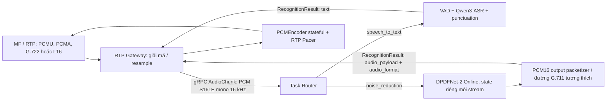

# THIẾT KẾ THỐNG NHẤT: AUDIO ENGINE TASK ROUTING VÀ DPDFNet-2 STREAMING 16 kHz

**Phiên bản:** 1.4 — 24/11/2026 (1.3 → 1.4: `noise_reduction` chỉ dùng cho cuộc gọi băng rộng G.722/L16, rtpgw tắt dịch vụ này với G.711, xem §3.3; 1.2 → 1.3: Gateway phát hết phần đuôi khi đóng session `noise_reduction`; 1.1 → 1.2: AI Engine đã code `noise_reduction` trên nhánh `feature/noise-reduction`; 1.0 → 1.1: đối chiếu code Gateway nhánh `feature/noise-reduction-service`; xem "Lịch sử thay đổi" cuối tài liệu)  
**Phạm vi:** Media Function (MF) ↔ RTP Gateway ↔ AI Audio Engine  
**Giao thức AI:** `speech.SpeechStream/Recognize` — gRPC hai chiều  
**Nguồn tổng hợp:** `DPDFNet2_Task_Routing_Design.md`, `wideband-codec-g722-l16-solution-v2-ai16k-VI.md`; code và tài liệu Gateway `media_ai` (nhánh `feature/noise-reduction-service`: `internal/ai/proto/speech.proto`, `docs/wideband-codec-g722-l16-solution.md`). File `speech_ai_wideband_v2.proposed.proto` mà bản 1.0 dẫn **không có trong repo**; proto hợp lệ là `media_ai/internal/ai/proto/speech.proto` (Gateway) và `asr_server/src/asr_server/proto/speech.proto` (AI, cùng tag).

> **Tài liệu thiết kế thống nhất:** Đây là bản đặc tả chính để tích hợp `noise_reduction` vào Audio Engine và Gateway. Gateway báo định dạng audio phải trả qua **`AudioChunk.output_audio_format` (field 14)**: `LEGACY_ENCODED` (vắng/0) ⇒ AI trả **G.711 PCMU 8 kHz** (chế độ băng hẹp, `media.codec=pcm`); `PCM_S16LE` ⇒ AI trả **PCM S16LE mono 16 kHz** có khai báo `audio_format=PCM_S16LE` (`media.codec=g722|l16`). Các phần lịch sử triển khai không được hiểu là xác nhận rằng mã AI wideband đã hoàn thiện.
>
> **Chỉ dùng `noise_reduction` cho G.722/L16 (từ bản 1.4).** Trên audio băng hẹp của cuộc gọi G.711, DPDFNet-2 làm nhỏ hẳn nhiều đoạn có tiếng (§3.3), nên rtpgw không dùng dịch vụ này khi `media.codec=pcm`. Đường trả PCMU của AI vẫn còn trong code để tương thích, nhưng không dùng ở production.

## 1. Mục tiêu, phạm vi và trạng thái

### 1.1. Mục tiêu

1. Tái sử dụng duy nhất RPC streaming `SpeechStream.Recognize` cho các dịch vụ âm thanh, lựa chọn pipeline dựa trên `AudioChunk.task`.
2. Giữ nguyên xử lý `speech_to_text` hiện có (VAD → Qwen3-ASR → punctuation), không đưa task khác qua ASR một cách ngầm định.
3. Bổ sung `noise_reduction` bằng **DPDFNet-2** ở chế độ online, nhận PCM16 mono 16 kHz và trả audio liên tục, không chờ kết thúc câu.
4. Hỗ trợ Gateway dùng G.722/L16 trên RTP mà vẫn duy trì PCM16 16 kHz ở giao diện AI. Với `media.codec=pcm` (G.711), `speech_to_text` chạy như cũ; `noise_reduction` không dùng (§3.3).
5. Giữ tương thích các số trường protobuf đã có: tag 1–13 của `AudioChunk` (thêm 14), tag 1–16 và 20–24 của `RecognitionResult`.

### 1.2. Định tuyến theo task

| `AudioChunk.task` | Pipeline | Kiểu kết quả | Trạng thái của Audio Engine nguồn |
|---|---|---|---|
| `speech_to_text` hoặc rỗng | VAD → Qwen3-ASR → punctuation | `RecognitionResult.text`, partial/final | Đã có, phải giữ nguyên |
| **`noise_reduction`** | **DPDFNet-2 online → đóng gói audio** | `audio_payload` cùng `audio_format` | **Đã code**, đã vào `main` (PR #1, `c9e752c`): `noise_service.py`, `denoise.py`; bật bằng `noise_reduction.enabled` (mặc định tắt ⇒ `UNIMPLEMENTED`). Chỉ cho G.722/L16 (§3.3) |
| `realtime_translation` | ASR → dịch | Chưa định nghĩa ở bản này | `UNIMPLEMENTED` |
| `keyword` | Phát hiện từ khóa | Chưa định nghĩa ở bản này | `UNIMPLEMENTED` |
| `voice_controller_emoji` | Phát hiện lệnh/emoji | Chưa định nghĩa ở bản này | `UNIMPLEMENTED` |
| Task không nhận diện | Không xử lý | Lỗi | `INVALID_ARGUMENT` |

**Giới hạn:** Không bao gồm PLC (che giấu mất gói RTP), tách người nói mục tiêu, hỗ trợ stereo, đàm phán nhiều codec/fallback cùng SDP hoặc bảo đảm chất lượng trên mọi loại nhiễu. DPDFNet-2 sử dụng đầu ra RAW, chưa bật mix 6/12 dB mặc định.

### 1.3. Phân biệt trạng thái triển khai và thiết kế

- **Audio Engine:** bản `audio-engine-dpdfnet2-task-router.zip` **không có trong repo**; `noise_reduction` được viết mới trên nhánh `feature/noise-reduction` (tạo từ `feature/word-reveal`, đã merge vào `main` qua PR #1, `c9e752c`): khóa `asr.enabled` và mục `noise_reduction` trong `config.py`, định tuyến theo task, DPDFNet-2 qua sherpa-onnx 2.0.2, hai đường ra theo field 14. Proto AI đã đồng bộ tag 14/15/16 (`1eacc31`). **Đã chạy** với model DPDFNet-2 thật trên CPU laptop, qua client test (in-process và gRPC) và qua Gateway thật với mock MF (lab 24/11/2026, G.722, L16 và PCMU). **Chưa chạy** với MF thật, chưa đo trên CPU máy chủ, chưa đánh giá chất lượng trên thoại tiếng Việt băng rộng. Với thoại G.711 thì đã đo và quyết định không dùng (§3.3).
- **Gateway** (nhánh `feature/noise-reduction-service`, chưa merge `master`): đã có G.722/L16 + `audio_format` 15/16 (S1–S8); dịch vụ `noise_reduction` (`d84df2f`); fallback phát audio gốc khi AI lỗi (F1–F4, `e32bdd0`…`84f4ac5`); chờ có giới hạn trước khi bỏ result có audio (`e3d4ee5`, `7468676`, `da6b0fa`); đệm phát pacer (`f4687fa`, `eeeb905`); gửi `output_audio_format` field 14 (`336bd7c`); phát hết phần đuôi khi đóng session (`e7cec01`); mock MF + lab với AI engine thật (`90bd2b8`, `scripts/lab-noise-reduction.sh`). Đã chạy thật với mock worker và với AI engine thật (lab 24/11/2026); **chưa kiểm thử với MF thật**.
- **Tích hợp:** chưa có kiểm thử end-to-end với **DPDFNet-2 checkpoint thật + Gateway wideband + MF RTP thật**. Không coi kiểm thử bằng mock worker là nghiệm thu chất lượng âm thanh.

## 2. Kiến trúc tổng thể



**Đơn vị trạng thái:** Một RPC gRPC hai chiều tương ứng một bộ `(session_id, stream_id, task)` và **một chiều âm thanh**. Cuộc gọi A→B và B→A phải có hai ngữ cảnh model, bộ đệm và chuỗi sequence riêng. Nhiều cuộc gọi không dùng chung trạng thái RNN hoặc encoder.

Trong chế độ `noise_reduction`, không gọi VAD/ASR/punctuation; khoảng lặng, nền nhiễu và các lần bắt đầu nói lại đều được đưa qua cùng model online để bảo toàn timeline âm thanh (ngoại trừ các thay đổi do chính model gây ra).

**Đường dự phòng (Gateway):** khi AI không trả audio quá `noise_reduction.fallback_after_ms` (mặc định 500 ms), mất kết nối hoặc stream AI kết thúc, Gateway hủy stream AI và **phát lại audio gốc của MF đến hết cuộc gọi** (xem §5.5). Cuộc gọi không bị đóng.

## 3. Hợp đồng codec và tần số

### 3.1. Quy tắc cố định tại giao diện AI

- **Gateway → AI:** `AudioChunk.pcm` = PCM signed 16-bit little-endian, mono, **16.000 Hz**, không có header WAV.
- **AI → Gateway ở chế độ G.722/L16:** `RecognitionResult.audio_payload` = PCM signed 16-bit little-endian, mono, **16.000 Hz**, kèm `audio_format=PCM_S16LE` và `audio_sample_rate=16000`.
- **AI → Gateway ở chế độ G.711 cũ:** `audio_payload` chứa **payload G.711 PCMU đã mã hóa**, `audio_format=LEGACY_ENCODED`, `audio_pt=0`. **Không dùng PCMA:** session `pcm` của Gateway luôn chào PCMU và egress luôn phát PT 0, `audio_pt` bị bỏ qua khi phát ⇒ byte PCMA sẽ bị giải mã như µ-law (méo tiếng).
- **AI chọn định dạng theo `AudioChunk.output_audio_format` (field 14)** do Gateway gửi trên mọi chunk: vắng/`LEGACY_ENCODED` ⇒ G.711 PCMU; `PCM_S16LE` ⇒ PCM16 16 kHz. Không suy ra từ `rtp_clock_rate` (G.711 và G.722 cùng clock 8000) và không dùng cấu hình phía AI.
- Không được tự ý đặt PCM16 trong `audio_payload` khi `audio_format=LEGACY_ENCODED` hoặc bỏ trường định dạng; Gateway có nguy cơ phát nhiễu/méo tiếng.

### 3.2. Bảng thông số RTP

| `media.codec` | RTP/SDP | Tần số PCM bên Gateway | Đồng hồ RTP | Payload RTP / 20 ms | Bước timestamp RTP / 20 ms | AI trả về |
|---|---|---:|---:|---:|---:|---|
| `pcm` | PCMU PT 0, 8 kHz (Gateway chỉ chào PCMU) | 8 kHz, resample thành 16 kHz cho AI | 8.000 Hz | 160 byte | +160 | G.711 PCMU 8 kHz (legacy; `noise_reduction` không dùng, §3.3) |
| `g722` | PT 9, `G722/8000` | **16 kHz** | **8.000 Hz** | 160 byte | +160 | **PCM16 16 kHz** |
| `l16` | PT động, mặc định 96, `L16/16000` | **16 kHz** | **16.000 Hz** | 640 byte | +320 | **PCM16 16 kHz** |

Với L16, payload RTP trên dây là **big-endian** (RFC 3551); PCM tại giao diện gRPC dùng **little-endian**. G.722 có sample rate PCM 16 kHz nhưng clock RTP **8 kHz**: không được suy clock RTP từ `sample_rate` PCM.

`media.codec` hiện được cấu hình cho **toàn Gateway**, không lựa chọn theo từng dịch vụ. Gateway báo định dạng đầu ra **theo từng stream** qua `AudioChunk.output_audio_format` (field 14), nên một AI endpoint phục vụ được đồng thời Gateway legacy và wideband mà không cần tách endpoint/config; **không suy ra output codec từ `rtp_clock_rate`**.

### 3.3. `noise_reduction` chỉ cho G.722/L16; tắt với G.711

**Quyết định (24/11/2026):** chỉ dùng `noise_reduction` cho cuộc gọi băng rộng G.722/L16. Với G.711 (`media.codec=pcm`), **rtpgw** không dùng dịch vụ này: chạy Gateway với `media.codec` g722/l16 khi cần khử nhiễu, hoặc DCSF không chọn `noise_reduction` cho cuộc gọi G.711. Code rtpgw hiện tại (`feature/noise-reduction-service`, `e51e9bb`) vẫn nhận `noise_reduction` khi `media.codec=pcm`; việc chặn do người vận hành rtpgw lo. AI Engine **không đổi code**: nếu vẫn nhận stream yêu cầu PCMU thì vẫn phục vụ như trước.

**Lý do, đo trên laptop dev ngày 24/11/2026** với model thật (`dpdfnet2.onnx`, sherpa-onnx 2.0.2):

- Định dạng trả về đúng. Chạy thật Gateway `media.codec=pcm` + AI + DPDFNet-2: AI trả PCMU 8 kHz, MF nhận PT 0 × 160 byte.
- Khác biệt về chất lượng nằm ở model, không ở code. Với file `input.wav` (20 s), output gần như im lặng: −73,6 dBFS, trong khi input là −27,7 dBFS. Đã tách nguyên nhân:

  | Đầu vào DPDFNet-2 (cùng `input.wav`) | Output |
  |---|---|
  | Băng rộng 16 kHz (như G.722/L16) | −29,1 dBFS (bình thường) |
  | µ-law ở 16 kHz, giữ đủ băng tần | −29,1 dBFS |
  | Chỉ cắt băng tần 16→8→16 kHz | −84,6 dBFS |
  | Lọc thấp 3,4 / 5 / 6 kHz | −81,7 / −43,0 / −32,2 dBFS |

  Bộ mã hóa µ-law và bộ hạ mẫu FIR của AI giữ nguyên mức tín hiệu. Mức output tụt là do model nhận audio chỉ có dải dưới 4 kHz.
- Trên **cuộc gọi PCMU thật**, chỉ số đo là: trong 25% khung có tiếng to nhất, tỷ lệ khung bị làm nhỏ quá 20 dB. Hai mốc so sánh là p232 (giả lập G.711) 0% và `input.wav` 100%.
  - Dữ liệu: 15 luồng từ 2 pcap ingress của lab trong `media_ai/pcap/` (khoảng 19 phút), cộng bản `_in.wav` 16 kHz mà gateway ghi lại. 11 luồng đủ tiếng để đo; bỏ 3 luồng gần như im lặng và 2 luồng quá ngắn.
  - Các luồng thật nằm trong khoảng 11–54%.
  - 5 luồng bị 31–54%, với mức thay đổi trung vị −5 đến −24 dB.
  - Số liệu không tách được lời nói với âm to không phải lời nói (không có bản sạch để so), nên các đoạn đã được cắt ra để nghe A/B.
- Trên 6 mẫu VoiceBank giả lập G.711, STOI sau khử nhiễu lúc tăng lúc giảm (ví dụ 0,944→0,950 nhưng 0,982→0,962), nên khử nhiễu trên G.711 cũng không có lợi rõ ràng.
- Gateway không tự cứu được trường hợp này: AI vẫn trả audio đều đặn nên không kích hoạt fallback (§5.5), và MF chỉ nghe im lặng.

**Nếu sau này cần khử nhiễu cho G.711:** cần một cơ chế an toàn phía AI, ví dụ trả lại audio gốc khi output thấp hơn input quá X dB trong Y giây mà input vẫn có tiếng, hoặc trộn thêm một phần audio gốc. Ngoài ra phải đánh giá bằng cách nghe trên thoại G.711 thật. Đây là việc riêng, chưa làm.

## 4. Giao thức protobuf — không thay đổi số tag cũ

Sử dụng `speech.SpeechStream/Recognize`, không tạo RPC riêng. File proto đầy đủ: `media_ai/internal/ai/proto/speech.proto` (Gateway, kèm hợp đồng task `noise_reduction` dạng comment) và `asr_server/src/asr_server/proto/speech.proto` (AI; bản sao `tools/eval/speech.proto` phải giống từng byte — test `tests/test_proto_contract.py`). Các dòng dưới chỉ là **trích yếu**.

```proto
// AudioChunk (những field liên quan; giữ nguyên tag hiện có)
string session_id = 1;
string stream_id = 2;
bytes pcm = 3;
int32 sample_rate = 4;       // 16000 đối với noise_reduction
int32 channels = 5;          // 1 (0 chỉ khi cần tương thích client cũ)
uint32 rtp_timestamp = 6;
bool end_of_stream = 8;
string task = 10;
uint32 rtp_clock_rate = 11;  // 8000 với G.722/G.711; 16000 với L16
int64 chunk_seq = 12;
AudioFormat output_audio_format = 14;  // MỚI: định dạng audio_payload Gateway nhận; vắng/0 = G.711 PCMU, 1 = PCM16 16 kHz

// RecognitionResult (những field liên quan)
bool is_final = 4;
int64 ts_start = 5;
int64 ts_end = 6;
uint64 seq = 9;
bytes audio_payload = 10;          // G.711 PCMU nếu format=0; PCM S16LE nếu format=1
uint32 audio_pt = 11;              // chỉ có nghĩa với G.711 legacy; luôn 0 (PCMU)
AudioFormat audio_format = 15;     // tag wideband đã có trong thiết kế Gateway
int32 audio_sample_rate = 16;      // AI gửi rõ 16000 khi format=PCM_S16LE

enum AudioFormat {
  LEGACY_ENCODED = 0;
  PCM_S16LE = 1;
}
```

**Ràng buộc:**

1. Giữ nguyên tag 1–14 (`RecognitionResult` có 12–14 cho keyword), tag 20–24 dành cho metadata ASR; không tái sử dụng hoặc đổi ý nghĩa các tag này. `AudioChunk` thêm tag **14** (`output_audio_format`).
2. Gói protobuf AI đã đồng bộ tag **14/15/16** với Gateway (23/11/2026); Gateway có bộ giải mã `protowire` thủ công nên test kiểm byte thực tế trên dây (AI: `tests/test_proto_contract.py`; Gateway: `internal/ai/output_audio_format_test.go`), không chỉ biên dịch `.proto`.
3. Khóa `task`, `session_id`, `stream_id`, `sample_rate`, `rtp_clock_rate` và `output_audio_format` theo metadata ở đầu RPC; thay đổi giữa luồng trả `INVALID_ARGUMENT`. Với `noise_reduction`, `output_audio_format` ngoài {0, 1} cũng trả `INVALID_ARGUMENT`.
4. `chunk_seq` tăng liên tục theo luồng gửi; nếu có khoảng nhảy, ghi nhận sự cố đầu vào và áp dụng chính sách đã định, không tự tạo mẫu âm thanh bù nếu chưa có PLC.
5. `RecognitionResult.seq` tăng theo **mỗi bản tin trả về**, gồm cả bản tin final không có audio. Không dùng sequence input làm sequence output.
6. Với `noise_reduction`, **`ts_end` = `rtp_timestamp` (field 6) của chunk đầu vào mới nhất đã đưa vào model trước khi phát result**; `ts_start` = `ts_end` (Gateway không dùng `ts_start`). Lý do: Gateway tra `ts_end` **đúng bằng** `rtp_timestamp` của chunk đã gửi để đo độ trễ (`coordinator.observeAudioLatency` → `Stream.ReceivedAtOf`), và bước F5 (tự phục hồi) dự kiến dùng cùng cách. Mốc tính theo số mẫu đầu ra chỉ khớp khi biên đầu ra trùng biên chunk vào ⇒ phần lớn lần đo bị "miss". Result final rỗng cuối luồng dùng `ts_end` của chunk cuối (EOS).

### 4.1. Ma trận tương thích Gateway

| `media.codec` Gateway | `audio_format` AI | Hành động Gateway |
|---|---|---|
| `pcm` | `LEGACY_ENCODED=0` | Chuyển G.711 như trước |
| `pcm` | `PCM_S16LE=1` | Từ chối audio và ghi cảnh báo/metric; không làm hỏng text |
| `g722` / `l16` | `PCM_S16LE=1`, `audio_sample_rate=16000` | Mã hóa PCM thành codec RTP đã thỏa thuận |
| `g722` / `l16` | `LEGACY_ENCODED=0` | Từ chối audio để tránh phát byte sai định dạng |
| Bất kỳ | Sai format, sai sample rate, byte PCM lẻ | Từ chối, cảnh báo và tăng metric |

Khi AI làm đúng `output_audio_format` (field 14), hai dòng "từ chối" do lệch định dạng chỉ còn xảy ra khi có lỗi lập trình. Gateway giữ field 14 khớp egress bằng test `TestOutputAudioFormatFor_MatchesEgressSpec`.

## 5. Thiết kế streaming của `noise_reduction`

### 5.1. Tần suất trả audio và kích thước chunk

**Quyết định chính:** DPDFNet-2 trả **liên tục theo chunk**, không chờ VAD phát hiện hết câu hoặc ASR commit. Dữ liệu có thể được phát thành nhiều bản tin response độc lập với số bản tin request.

| Thời lượng | Số mẫu PCM16 mono 16 kHz | Số byte | Đề xuất |
|---|---:|---:|---|
| 10 ms | 160 | 320 | Thử nghiệm |
| **20 ms** | **320** | **640** | **Mặc định** |
| 40 ms | 640 | 1.280 | Tùy chọn giảm số message |
| 80 ms | 1.280 | 2.560 | Tương thích/thử nghiệm; không ưu tiên realtime |

Gateway hiện gửi chunk **80 ms** (`audio.chunk_ms: 80`, quyết định giữ nguyên của Gateway). Đầu ra nên đóng gói mặc định 20 ms. Ví dụ 80 ms đầu vào có thể tạo ra nhiều bản tin 20 ms, hoặc chưa tạo ra bản tin nào ở giai đoạn khởi động do bộ đệm model. **Không có ràng buộc 1 request ↔ 1 response.** Bước nội bộ của model không được đồng nhất với độ dài chunk gRPC.

Ràng buộc từ Gateway: mỗi result PCM nên mang **bội của 640 byte** (20 ms @16 kHz), để `PCMEncoder` không giữ phần dư giữa các result. Ở 20 ms/result mỗi stream phát 50 bản tin/giây. Gateway đo được trạng thái ổn định không mất gì, kể cả hàng đợi 16; chỉ mất khi worker **trả dồn** vượt hàng đợi (xem §6). Nếu đo tải AI thấy số bản tin là nút thắt, có thể đặt `frame_ms` 40/80: mỗi result gom nhiều frame 20 ms, vẫn là bội 640 byte.

### 5.2. Xử lý mỗi luồng

1. Nhận `AudioChunk` đầu tiên, xác thực metadata và `task=noise_reduction`, kiểm tra giới hạn số stream; đọc `output_audio_format` (field 14) để chọn đường ra (`PCM_S16LE` ⇒ FIFO PCM16 16 kHz; vắng/`LEGACY_ENCODED` ⇒ resample 16→8 kHz có trạng thái + mã hóa **PCMU**, frame 160 byte); tạo **một** `sherpa_onnx.OnlineSpeechDenoiser` DPDFNet-2 riêng. Code: lấy một bộ lọc **nạp sẵn** từ pool (nạp một bộ mất ~0,3 s, quá lâu cho ngưỡng 500 ms; `reset()` khi trả về cho kết quả giống hệt bộ mới — đã đo). Hạ mẫu 16→8 kHz dùng bộ lọc FIR tự viết (`audio.Downsampler16kTo8k`, Kaiser 127 tap, phẳng tới 3300 Hz): `soxr` dạng stream trả mẫu theo đợt (có chunk 80 ms ra 0 mẫu), vi phạm "audio cho mọi chunk".
2. Với mỗi chunk, giải mã little-endian PCM16 thành float32 chuẩn hóa `[-1, 1]`; giữ thứ tự input; gọi `denoiser.run(samples, 16000)`.
3. Đọc mẫu đầu ra từ đối tượng kết quả của `run()`, chuyển thành PCM16 có clipping kiểm soát; cộng vào **output FIFO** của chính stream.
4. Khi FIFO có từ 320 mẫu trở lên, trích ra mỗi khối 320 mẫu, phát `RecognitionResult(audio_format=PCM_S16LE, audio_sample_rate=16000, is_final=false, ts_end=<rtp_timestamp chunk vào mới nhất>)` ngay. Có thể gom 640 mẫu nếu cấu hình output 40 ms. Chế độ legacy: `audio_format=LEGACY_ENCODED`, `audio_pt=0`, payload PCMU 160 byte/20 ms.
5. Duy trì FIFO phần dư; **không thêm zero padding sau mỗi lần `run()`**, không reset model lúc im lặng và không trộn lại input ở mức 6/12 dB theo mặc định.
6. Mọi tác vụ inference trên cùng stream phải tuần tự; không gọi blocking inference trực tiếp trên event loop gRPC. Nhiều stream được phục vụ song song trong giới hạn worker/tài nguyên.
7. Cuối luồng: xử lý hết PCM đầu vào; gọi `denoiser.flush()` **một lần**; đưa các mẫu còn lại vào FIFO; gửi toàn bộ khối đầy đủ và một khối cuối có thể ngắn hơn 20 ms; sau đó phát bản tin final rỗng. Gateway (từ `e7cec01`) vẫn phát phần đuôi này cho MF khi đóng session, xem §5.3.

**Độ trễ:** Trước đây đo được khoảng 40 ms lệch thời gian ở một bộ test. Đây là giá trị quan sát, **không hardcode bù 40 ms trong media path** trước khi xác nhận chính xác mapping offset/timestamp và phiên bản model/runtime.

### 5.3. Quy tắc `is_final`: khác ASR

| Task | Ý nghĩa `is_final=true` |
|---|---|
| `speech_to_text` | Hoàn thành một đoạn phát ngôn/utterance, commit text |
| **`noise_reduction`** | **Kết thúc toàn bộ audio stream** sau khi `denoiser.flush()` và trả hết PCM còn đệm |

- Audio bình thường: `is_final=false` trong toàn bộ cuộc gọi, kể cả các đoạn im lặng hoặc người nói tạm nghỉ.
- Không gửi final định kỳ 20/40/80 ms và không gửi final do VAD. Một final giữa cuộc gọi khiến Gateway `PCMEncoder.Flush()` và có thể chèn im lặng nhân tạo cuối khung.
- Khi nhận `AudioChunk.end_of_stream=true` hoặc client **half-close có trật tự**, server hoàn tất xử lý và phát **đúng một** final rỗng: `audio_payload=b""`, `is_final=true`, `audio_format` theo `output_audio_format` của stream (PCM: kèm `audio_sample_rate=16000`), `seq` tăng một lần. Gateway nhận final rỗng ở cả session G.711 lẫn G.722/L16: chỉ xả phần dư, không kiểm định dạng (`audio_egress.go`).
- Khi client hủy RPC cưỡng bức (gồm cả lúc Gateway chuyển sang fallback, §5.5): giải phóng state và ghi metric; không cam kết gửi được final. Không phát final trùng nếu cùng lúc có EOS flag và half-close.
- **Phần đuôi khi đóng session được phát hết** (Gateway `e7cec01`, 24/11/2026; trước đó là quyết định 23/11/2026 chấp nhận mất đuôi). Gateway vẫn gửi EOS trong bước xả sau khi session chuyển `CLOSING`, nhưng session `noise_reduction` có `PlayoutOnClose`: egress vẫn phát audio AI ở `CLOSING`, và bước xả chờ AI trả final và hàng đợi egress phát hết, trong giới hạn `session.drain_timeout_ms`. Fallback không chạy khi đã `CLOSING`. Lab 24/11/2026 (G.722, L16) nhận đủ 1000/1000 khung. Phần đuôi đi ra **sau** khi session bị xóa (EOS chỉ được gửi trong bước xả sau `DELETE`), nên đến MF khi chặng gọi đã kết thúc (lab: khung cuối sau một bước nhảy ts ≈ thời gian từ gói cuối tới `DELETE`); vẫn giữ để phần đuôi không bị cắt khi MF còn nhận. **Vẫn mất:** ~40 ms cuối của âm thanh vào (độ trễ thuật toán của model: số mẫu ra bằng số mẫu vào), và mọi audio AI trả về sau `drain_timeout_ms`.

### 5.4. Ví dụ chuỗi bản tin

```mermaid
sequenceDiagram
    participant MF as MF/RTP
    participant GW as Gateway
    participant AI as AI DPDFNet-2
    MF->>GW: RTP G.722 hoặc L16, ptime 20 ms
    GW->>AI: AudioChunk #0, 80 ms PCM16 16 kHz, task=noise_reduction, output_audio_format=PCM_S16LE
    GW->>AI: AudioChunk #1, 80 ms PCM16 16 kHz
    Note over AI: Giữ model state qua các chunk
    AI-->>GW: RecognitionResult #0, 640 B PCM, final=false, ts_end = rtp_ts chunk #1
    AI-->>GW: RecognitionResult #1, 640 B PCM, final=false, ts_end = rtp_ts chunk #1
    GW->>MF: RTP 20 ms theo pacer, không phát dồn
    Note over GW: Cuộc gọi kết thúc (DELETE): session CLOSING; noise_reduction: egress còn chạy (PlayoutOnClose)
    GW->>AI: AudioChunk end_of_stream=true (hoặc half-close)
    AI-->>GW: PCM còn lại, final=false
    AI-->>GW: RecognitionResult cuối, payload rỗng, final=true
    Note over GW: Session CLOSING, noise_reduction: vẫn phát phần đuôi tới hết drain_timeout_ms (§5.3)
```

### 5.5. Hợp đồng với cơ chế fallback của Gateway

Gateway (F1–F4, mặc định `noise_reduction.on_ai_failure: passthrough`) theo dõi sức khỏe stream AI mỗi 20 ms. Session chuyển **một chiều** sang FALLBACK đến hết cuộc gọi khi:

- đã gửi chunk mà **không nhận audio AI nào** quá `noise_reduction.fallback_after_ms` (mặc định 500 ms; chỉ result **có audio** mới tính, text không tính);
- mất kết nối/đang kết nối lại quá ngưỡng; hoặc
- stream AI kết thúc (kể cả do AI trả lỗi).

Khi vào FALLBACK, Gateway **hủy stream AI**, ngừng gửi audio cho AI, phát lại payload RTP gốc của MF và bỏ mọi result AI về sau. Chưa có tự phục hồi giữa cuộc gọi (bước F5 riêng của Gateway). Do đó AI **bắt buộc**:

1. **Trả audio cho mọi chunk, kể cả im lặng**: không lọc VAD, không giữ lại audio "không có tiếng nói".
2. **Độ trễ đến audio đầu tiên và giữa hai lần trả audio < 500 ms**, gồm khởi tạo model, hàng chờ inference và trễ thuật toán. Worker khỏe mà chậm vẫn bị coi là treo và mất khử nhiễu đến hết cuộc gọi. Vì vậy khi quá tải phải **từ chối sớm** (`RESOURCE_EXHAUSTED` lúc mở stream, Gateway chuyển ngay sang audio gốc), không xếp hàng làm chậm mọi stream.
3. Khi bị hủy (cancel), giải phóng slot/model ngay; không chờ EOS, không gửi final.
4. Giới hạn đã biết của Gateway: AI chết ngay lúc mở cuộc gọi (dial lỗi) làm cuộc gọi bị từ chối; khi chuyển nguồn có khoảng lặng ≈ `fallback_after_ms` + một chunk (đo được 520–560 ms) và có thể nghe click nhỏ (trạng thái ADPCM G.722).

## 6. Xử lý output ở Gateway

1. Với mode G.722/L16, kiểm tra `audio_format=PCM_S16LE`, `audio_sample_rate=16000`, kích thước `audio_payload` chẵn; không áp dụng `audio_pt` G.711 cho PCM.
2. Duy trì **một PCMEncoder stateful theo session**. `Write()` cộng mẫu mới vào bộ đệm, encode **chỉ các frame 20 ms đầy đủ**; phần dư giữ lại cho chunk sau, không đệm số 0 giữa chừng.
3. Khi `is_final=true`, gọi `PCMEncoder.Flush()` đúng một lần, chỉ lúc này mới đệm zero cho phần khung cuối chưa đầy; sau đó phát RTP qua **pacer 20 ms**.
4. G.722: 320 mẫu PCM16 (640 byte) → 160 byte RTP PT 9, timestamp RTP tăng **160**.
5. L16: 320 mẫu PCM16 (640 byte) → 640 byte RTP PT động mặc định 96, timestamp RTP tăng **320**; trên RTP đổi LE → BE.
6. Gateway không được phát dồn nhiều gói RTP ở cùng thời điểm khi nhận nhiều response gRPC liên tiếp; pacer chịu trách nhiệm nhịp phát ra MF.
7. Chế độ `media.codec=pcm` tiếp tục xử lý payload G.711 kiểu cũ, **luôn phát PT 0 (PCMU)**, `audio_pt` của AI không được dùng. Với codec/format không khớp, **không có fallback âm thầm chuyển bytes**; từ chối và ghi nhận lỗi.
8. **Đệm phát** (đã làm, `f4687fa`): `noise_reduction.egress_playout_delay_ms` (0..500, mặc định 0 = tắt; chỉ áp cho session `noise_reduction`). Pacer giữ frame đầu và frame sau mỗi underrun cho đến khi đã chờ đủ ngần đó ms, làm tròn lên bội 20 ms. Mô phỏng của Gateway: 40 ms khử hết gap với jitter kết quả cỡ chục ms. Đổi lại, độ trễ tăng đúng bằng giá trị đặt, và mỗi lần worker để cạn hàng đợi thì đứng tiếng tối đa ngần đó.
9. **Hàng đợi result** (đã làm, `e3d4ee5`/`7468676`/`da6b0fa`): result có audio gặp hàng đợi đầy sẽ chờ tối đa `ai.audio_result_wait_ms` (mặc định 100) rồi mới bỏ. Sau 3 lần chờ hết giờ liên tiếp thì bỏ ngay (cầu dao). Metric `media_ai_ai_audio_result_dropped_total`. Hàng đợi `session.per_session_result_queue` đang là 32 ở prod/-ims/-ha; nên nâng nếu AI trả dồn lớn.

**Khuyến nghị vận hành:** Buffer/pacer Gateway phải chịu được biến động thời gian inference; đo độ trễ đến frame đầu tiên, p95/p99 độ trễ, RTP underrun (gói có marker/nhảy ts trên egress) và `audio_result_dropped_total` trước khi chọn `egress_playout_delay_ms` (gợi ý lab: 40).

## 7. Cấu hình triển khai

### 7.1. Gateway (cấu hình trong YAML khi chạy có `--config`)

```yaml
media:
  codec: g722           # pcm | g722 | l16
  l16_payload_type: 96  # dùng khi codec=l16; tránh PT 101 telephone-event
```

`media.codec=pcm` là mặc định tương thích ngược. Khi K8s sử dụng `--config=/etc/gateway/gateway.yaml`, khóa YAML có hiệu lực; không trông chờ flag/env tự ghi đè. Phiên G.722 được SDP công bố bằng `G722/8000`, nhưng session PCM có sample rate 16000.

Khóa liên quan `noise_reduction` (có trong 7 file `config/*.yaml` và `deploy/k8s/configmap.yaml` của Gateway). Dịch vụ được bật/tắt do DCSF qua `selectedService=noise_reduction`, Gateway không có khóa bật/tắt riêng:

```yaml
audio:
  chunk_ms: 80                    # kích thước chunk gửi AI
ai:
  audio_result_wait_ms: 100       # 0 = tắt chờ; 0..5000
noise_reduction:
  on_ai_failure: passthrough      # passthrough (phát audio gốc) | close (hành vi cũ: đóng session)
  fallback_after_ms: 500          # 100..60000
  egress_playout_delay_ms: 0      # 0..500; gợi ý lab 40
```

### 7.2. AI Audio Engine — cấu hình đích được đề xuất

```yaml
asr:
  enabled: true

noise_reduction:
  enabled: true
  model: /opt/models/dpdfnet2.onnx
  frame_ms: 20               # đơn vị đóng gói output (bội 20 ms)
  num_threads: 1
  workers: 2
  max_streams: 16            # vượt ⇒ RESOURCE_EXHAUSTED ngay khi mở stream (không xếp hàng, xem §5.5)
  max_backlog_ms: 500        # audio chờ model vượt mức này ⇒ đóng stream RESOURCE_EXHAUSTED; 0 = tắt
```

**Không có khóa định dạng đầu ra** (`output_format`/`output_pt` của bản 1.0 đã bỏ): định dạng lấy theo từng stream từ `AudioChunk.output_audio_format`. **Đã có** trong `config.py` (nhánh `feature/noise-reduction`) với các khóa trên, trừ `model` mặc định là `/opt/models/dpdfnet2.onnx` (`update.sh` đổi thành `APP/model` cho máy cài mới) và `noise_reduction.enabled` mặc định `false`; kiểm tra lúc nạp: bật ít nhất một task, `frame_ms` ∈ {20, 40, 80}, `max_streams` ≤ `server.max_streams`. Engine không có configmap K8s; cấu hình chỉ ở `config/server.yaml` của thư mục chạy, `--check-config` in ra các khóa; `bin/env.sh` không cần biến mới. Có thể đặt `asr.enabled=false` để triển khai chỉ DPDFNet-2 trên CPU. `max_streams` và `workers` phải chọn theo đo p99 độ trễ < `fallback_after_ms` của Gateway, không phải số cuộc gọi đồng thời đã được kiểm nghiệm.

**Ma trận định dạng (tự động theo field 14):**

| Gateway | `output_audio_format` Gateway gửi | AI trả |
|---|---|---|
| `media.codec=pcm` | vắng (0 = `LEGACY_ENCODED`) | G.711 PCMU 8 kHz, `audio_pt=0` |
| `media.codec=g722` | `PCM_S16LE` (1) | PCM16 16 kHz → Gateway encode G.722 |
| `media.codec=l16` | `PCM_S16LE` (1) | PCM16 16 kHz → Gateway encode L16 |

**Triển khai đồng thời:** một AI instance phục vụ được cả Gateway legacy và wideband trên cùng cổng, vì định dạng đi theo từng stream.

### 7.3. Thư viện và model

- Model: **DPDFNet-2 16 kHz ONNX**, sử dụng `sherpa_onnx.OnlineSpeechDenoiser` và giữ context riêng cho từng stream.
- Nguồn model đã nêu trong thiết kế trước: `https://github.com/k2-fsa/sherpa-onnx/releases/download/speech-enhancement-models/dpdfnet2.onnx`.
- Triển khai offline: tải sẵn model, kiểm tra SHA-256 và khóa phiên bản wheel/runtime; không tự tải model lúc server khởi động.
- Có thể chạy CPU cho kiểm thử; thông lượng và số stream đồng thời phải đo trên phần cứng đích. Tránh inference blocking trên event loop của gRPC.

## 8. Kiểm tra lỗi, giám sát và an toàn

| Tình huống | Hành vi AI | Phản ứng Gateway (session `noise_reduction`, `on_ai_failure=passthrough`) |
|---|---|---|
| PCM lẻ byte, sample rate khác 16000, sai định dạng/metadata luồng, `output_audio_format` lạ | `INVALID_ARGUMENT` (Gateway cũng có thể tự từ chối payload) | Lỗi vĩnh viễn, không thử lại ⇒ stream kết thúc ⇒ FALLBACK `stream_ended`, phát audio gốc |
| Task được biết nhưng chưa triển khai / noise task bị tắt | `UNIMPLEMENTED` | Như trên |
| Vượt giới hạn số stream | `RESOURCE_EXHAUSTED` ngay khi mở stream | Thử lại theo `ai.max_retry`; quá `fallback_after_ms` hoặc hết lượt ⇒ FALLBACK, phát audio gốc |
| Model không khởi tạo được / inference lỗi | `UNAVAILABLE`, ghi log và metric | Như trên; cuộc gọi không bị đóng |
| AI chậm/treo (không trả audio ≥ 500 ms) | — | FALLBACK `stalled`, hủy stream AI (AI nhận cancel) |
| CPU không theo kịp: audio chờ model > `noise_reduction.max_backlog_ms` (500) | `RESOURCE_EXHAUSTED`, log `noise_reduction backlog` | Stream kết thúc ⇒ FALLBACK, phát audio gốc (thay vì nhận audio ngày càng trễ mà vẫn coi là khỏe) |
| Format Gateway và AI không khớp | — | Không phát RTP sai định dạng; cảnh báo và tăng `media_ai_egress_audio_rejected_total{reason}`. Vì vẫn tính là đã trả audio nên **không** kích hoạt FALLBACK: MF nhận im lặng ⇒ phải bắt bằng test field 14 |
| EOS sạch | Flush model, phát phần đuôi và một final rỗng | Session `CLOSING`: vẫn phát phần đuôi, chờ final tối đa `drain_timeout_ms` (§5.3) |
| Hủy cưỡng bức / mất mạng | Giải phóng tài nguyên ngay; không chờ vô hạn | — |

Các lý do từ chối audio Gateway đã được tài liệu S7 ghi nhận: `format_unsupported`, `format_mismatch`, `bad_sample_rate`, `odd_bytes`, `unknown_format`, `encode_error`; không mặc định rằng mọi trường hợp lỗi đều đã được thử trên MF thật.

Giám sát tối thiểu bổ sung: số stream DPDFNet-2 đang hoạt động, số chunk/mẫu nhận và trả, độ trễ đến audio đầu tiên, inference latency p50/p95/p99, thời lượng audio chờ (ms), số final đã gửi, thiếu dữ liệu RTP (underrun), số chunk bị từ chối và số stream hủy. Các tên metric AI mới cần thống nhất khi viết code, không coi là metric đã tồn tại.

Khi vận hành liên node, triển khai TLS/mTLS, xác thực nguồn gRPC, giới hạn lưu lượng và thời gian xử lý; source Audio Engine hiện được mô tả là dùng plaintext.

## 9. Bộ kiểm thử/tiêu chí nghiệm thu

| Nhóm | Bài thử | Điều kiện đạt |
|---|---|---|
| Định tuyến | 5 giá trị `task`, task rỗng và task lạ | STT không đổi; noise đúng model; task chưa làm `UNIMPLEMENTED`; task lạ `INVALID_ARGUMENT` |
| Chuẩn hóa | WAV stereo/44,1 kHz đã qua Gateway; chunk PCM 16 kHz 19/20/21/79/80/81 ms | Audio đúng mono PCM16; không mất/lặp mẫu |
| Streaming | Cùng PCM chia chunk 20/40/80 ms | Kết quả khớp trong sai số runtime; không reset state qua silence |
| Đóng gói | Output 20 ms 640 byte; frame cuối lẻ | Không chèn zero giữa các chunk; phần dư trả trước final |
| Final | Hàng trăm chunk liên tục và EOS | Mọi chunk thường `false`; đúng **một** final rỗng `true` sau flush; không final tại silence |
| Metadata | Tag 14/15/16, rate sai, PCM byte lẻ, format/codec sai | Không phát bytes sai định dạng; log/metric đúng |
| Chọn định dạng | `output_audio_format` vắng / 0 / 1 / giá trị lạ / đổi giữa luồng | Vắng, 0 ⇒ PCMU `audio_pt=0`; 1 ⇒ PCM16 16 kHz kèm `audio_sample_rate=16000`; lạ hoặc đổi ⇒ `INVALID_ARGUMENT` |
| Hợp đồng fallback | Im lặng dài; khởi động model; quá tải `max_streams`; cancel từ Gateway | Có audio cho mọi chunk; audio đầu tiên < 500 ms; vượt `max_streams` ⇒ `RESOURCE_EXHAUSTED` ngay; cancel giải phóng slot |
| `ts_end` | Chunk 80 ms, output 20 ms | Mọi result có `ts_end` bằng `rtp_timestamp` một chunk đã nhận (Gateway đo được độ trễ, không "miss") |
| G.722 | AI PCM 640 byte / 20 ms | RTP PT 9 / 160 byte / TS +160 / pacing 20 ms |
| L16 | AI PCM 640 byte / 20 ms | RTP PT cấu hình / 640 byte BE / TS +320 / pacing 20 ms |
| G.711 legacy | Gateway `media.codec=pcm` | `speech_to_text`: kết quả, PT và callflow cũ không đổi. `noise_reduction` không dùng với G.711 (§3.3) |
| Đóng session | EOS vs half-close vs hủy đột ngột | Không double flush; không treo RPC; phía Gateway phát hết phần đuôi trước khi đóng (lab: 1000/1000 khung) |
| Hiệu năng | Nhiều luồng, 30 phút, tiếng nói và im lặng xen kẽ | Đo CPU/RAM/RTF, latency p95/p99, underrun; không dùng một con số giả định |
| Chất lượng | Tiếng Việt sạch + nhiễu công trường, hội trường, bệnh viện, ga tàu, sân bay | Không làm mất lời nói; đánh giá nghe A/B, SIG/BAK/OVRL, STOI/SNR khi có clean target |
| End-to-end | Gateway + AI thật + MF RTP thật | Có log/pcap chứng minh payload, thời gian và chất lượng hai chiều |

**Đặc biệt:** Không dùng riêng DNSMOS BAK hoặc mức giảm RMS để kết luận giọng người gọi được bảo toàn. Với DPDFNet-4/8 từng có trường hợp triệt nhầm tiếng nói, nên giai đoạn này chỉ đưa **DPDFNet-2 RAW** vào thiết kế; đánh giá và fine-tune tiếp bằng dữ liệu thoại thực tế nếu cần.

## 10. Phân chia công việc và tình trạng hiện có

| Thành phần | Đã có theo nguồn cung cấp | Công việc cần hoàn tất |
|---|---|---|
| Gateway G.722/L16 + `noise_reduction` | Nhánh `feature/noise-reduction-service`: S1–S8, dịch vụ `noise_reduction`, fallback F1–F4, chờ result có audio, đệm phát pacer, gửi field 14 (`336bd7c`), phát hết phần đuôi (`e7cec01`); chạy thật với mock worker và AI engine thật | Merge `master`; lab MF thật; F5 (tự phục hồi giữa cuộc gọi) là việc riêng |
| Gateway — điểm yếu đã biết | Bộ đếm treo được xóa khi nhận **bất kỳ** result có audio (`grpc_client.go:508-511`), kể cả audio sau đó bị egress từ chối vì sai định dạng | Nếu muốn: chỉ tính audio egress nhận được (việc của Gateway, chưa làm) |
| AI task router | Chunk đầu chọn task: `noise_reduction` ⇒ `NoiseReductionService` khi bật; STT không đổi (toàn bộ test STT cũ vẫn qua); `asr.enabled=false` ⇒ STT `UNIMPLEMENTED` (`29e08ed`) | — |
| AI DPDFNet-2 | `denoise.py`: pool nạp sẵn, `NoiseStream` hai đường ra theo field 14, khung `frame_ms`, µ-law, hạ mẫu FIR (`e1dff04`); nạp model trong `serve()` (L4). Model thật: audio đầu tiên 16 ms, model 13–21 ms mỗi chunk 80 ms (CPU laptop, 1 luồng) | Đo trên CPU máy chủ để chọn `max_streams`/`workers`; đánh giá chất lượng trên thoại thật |
| AI protobuf | **Đã đồng bộ** tag 14/15/16 + `AudioFormat`, sinh lại `speech_pb2.py` (2 bản), test `tests/test_proto_contract.py` (`1eacc31`) | — |
| AI gRPC result | `noise_service.py`: audio mọi chunk, `ts_end` theo §4 ràng buộc 6, một final rỗng, mã lỗi §8, một dòng log tóm tắt mỗi stream (`29e08ed`); chặn backlog `max_backlog_ms` (L5) | — |
| Config và client | Khóa §7.2 trong `config.py`, `config/server.yaml`, README, `HUONG_DAN_CAI_DAT.md` (`22c7e09`, L4) | `scripts/update.sh` chỉ kiểm tra model của task đang bật, kể cả `dpdfnet2.onnx` và `sherpa-onnx` (`fbc4e7d`, `be3549e`). Còn: client test `scripts/client.py` và `tools/eval` chưa gửi `noise_reduction` (lab dùng `media_ai/cmd/mock-mf-wav`) |
| End-to-end | Mock AI wideband + fallback đã chạy thật phía Gateway | Dùng checkpoint DPDFNet-2 thật, stress/gap/cancel và kiểm thử chất lượng |

**Quy trình triển khai đề xuất:** (1) ✅ đồng bộ protobuf; (2) config AI và routing; (3) denoiser + packetizer + final + `ts_end`; (4) test đơn vị và gRPC (gồm hợp đồng fallback §5.5); (5) test với Gateway G.722/L16 + PCMU bằng engine thật; (6) kiểm tra PCAP/RTF/QoE và triển khai có kiểm soát. Không coi tài liệu này là xác nhận source AI đã được cập nhật.

## 11. Các quyết định cần giữ ổn định

1. **Chỉ DPDFNet-2** cho `noise_reduction` ở giai đoạn này; không tự động chuyển sang DPDFNet-4/8.
2. **Một RPC/chiều thoại**, một instance model, một bộ đệm output, một chuỗi `seq`; không chia sẻ state giữa các phiên.
3. **PCM16 16 kHz liên tục và chunk 20 ms** là hợp đồng wideband; không đợi commit câu nói.
4. **`is_final=true` duy nhất tại EOS** ở nhánh giảm nhiễu; ASR vẫn dùng final theo utterance.
5. **Tag 15/16** là cách AI khai báo định dạng audio trả về; **tag 14 của `AudioChunk`** là cách Gateway yêu cầu định dạng. Không tạo trường `enhanced_pcm` trùng vai trò; tag cũ giữ nguyên.
6. G.711 legacy là **chế độ riêng, tường minh, chỉ PCMU** (`audio_pt=0`); không trộn lẫn với PCM16 cùng một stream.
7. **Clock RTP khác sample rate PCM** với G.722: 8000 tick/s vs 16000 mẫu/s.
8. Gateway có trách nhiệm **encode RTP, pacing và fallback khi AI lỗi**; AI không sinh gói RTP.
9. Mọi nội dung chưa chạy với checkpoint/model thật được ghi là **cần kiểm thử**, không diễn đạt thành kết quả đã nghiệm thu.
10. **Phần đuôi khi đóng session được phát hết** (Gateway `PlayoutOnClose`, chờ final tối đa `drain_timeout_ms`); chỉ mất ~40 ms độ trễ của model và audio AI trả về sau `drain_timeout_ms` (hoặc khi session đã ở fallback). Thay quyết định 23/11/2026 "chấp nhận mất đuôi".
11. **`ts_end` = `rtp_timestamp` của chunk vào mới nhất** đã đưa vào model (`ts_start` = `ts_end`).
12. **Audio cho mọi chunk, độ trễ < `fallback_after_ms`**; quá tải thì từ chối sớm.
13. **`noise_reduction` chỉ cho G.722/L16**: rtpgw không dùng dịch vụ này với G.711 vì DPDFNet-2 làm nhỏ hẳn nhiều đoạn có tiếng trên audio băng hẹp (§3.3). Đường PCMU của AI chỉ còn để tương thích.

---

**Kết luận thiết kế:** Một gRPC `SpeechStream.Recognize` phục vụ các task theo định tuyến tường minh. `speech_to_text` giữ nguyên. `noise_reduction` dùng DPDFNet-2 để trả audio **theo chunk bội 20 ms, liên tục cho mọi chunk**, theo định dạng Gateway yêu cầu ở `output_audio_format` (PCM16 16 kHz cho G.722/L16; đường G.711 PCMU chỉ còn để tương thích, không dùng, §3.3). Mỗi stream giữ state riêng và phát **một final rỗng duy nhất khi kết thúc**. Gateway dùng tag 15/16 để phân biệt PCM và G.711, mã hóa G.722/L16, phát RTP theo pacer, và phát audio gốc khi AI lỗi hoặc chậm quá `fallback_after_ms`. Đây là bản thiết kế duy nhất để cập nhật AI Engine và đối chiếu tích hợp Gateway trong giai đoạn tiếp theo.

## Lịch sử thay đổi

**1.4 — 24/11/2026:**

- Quyết định chỉ dùng `noise_reduction` cho G.722/L16; với G.711 thì rtpgw không dùng dịch vụ này (do người vận hành rtpgw cấu hình), AI Engine không đổi code. Thêm §3.3 kèm số đo; cập nhật hộp tóm tắt, §1.1, §1.2, §1.3, §3.2, §9, quyết định 13 và phần kết luận.
- AI Engine đã vào `main` (PR #1, `c9e752c`).

**1.3 — 24/11/2026:**

- Gateway `e7cec01` (`PlayoutOnClose`): session `noise_reduction` phát hết phần đuôi AI trả sau EOS trước khi đóng (giới hạn `drain_timeout_ms`); cập nhật §5.2, §5.3, §5.4, §8, §9, quyết định 10. Lab nhận đủ 1000/1000 khung (trước đó 999).
- AI Engine: sửa sau review cả nhánh (`47fb3d8`): giới hạn 64 chunk chỉ áp khi tắt `max_backlog_ms`; chunk `end_of_stream` không bị chặn bởi ngưỡng; đóng RPC thì trả bộ lọc ngay; nạp bộ lọc thay thế trên luồng riêng.

**1.2 — 23/11/2026** (code AI Engine trên nhánh `feature/noise-reduction`):

- Đã code `noise_reduction` theo tài liệu: cấu hình (`22c7e09`), lõi DPDFNet-2 (`e1dff04`), RPC + định tuyến (`29e08ed`), nạp model trong `serve()` và test model thật (L4).
- Pool bộ lọc nạp sẵn (đo: nạp 0,24–0,36 s, ~20 MB mỗi bộ; `reset()` cho kết quả giống bộ mới); bộ lọc lỗi được nạp lại.
- Hạ mẫu 16→8 kHz bằng FIR tự viết thay `soxr` (soxr dạng stream trả mẫu theo đợt).
- L5: chunk được đọc ngay khi tới vào hàng đợi; audio chờ model vượt `noise_reduction.max_backlog_ms` (mặc định 500, 0 = tắt) ⇒ `RESOURCE_EXHAUSTED`. Chọn 500 (không phải 300): ngắt nhầm mất khử nhiễu đến hết cuộc gọi (fallback một chiều), Gateway có thể gửi dồn 4–5 chunk sau một lần nghẽn, và 500 trùng `fallback_after_ms`.
- Đo trên model thật: giữ lại 160 mẫu, `flush` trả nốt, tổng ra = tổng vào, độ trễ 40 ms, kết quả không phụ thuộc kích thước chunk.

**1.1 — 23/11/2026** (đối chiếu code Gateway `feature/noise-reduction-service` HEAD `eeeb905`; quyết định do người dùng chốt cùng ngày):

- Định dạng đầu ra do Gateway báo qua **`AudioChunk.output_audio_format` (field 14)**; bỏ khóa AI `output_format`/`output_pt`.
- Chế độ G.711 **chỉ PCMU**: Gateway luôn phát PT 0 và bỏ qua `audio_pt`.
- Bỏ yêu cầu Gateway chờ final/drain RTP trước `CLOSING`; **chấp nhận mất đuôi** (§5.3).
- Quy tắc **`ts_end`** theo `rtp_timestamp` chunk vào (§4 ràng buộc 6), khớp cách Gateway đo độ trễ.
- Thêm **§5.5 hợp đồng fallback** (audio mọi chunk, < 500 ms, hủy stream); §6 đệm phát pacer và chờ result có audio; §7.1 khóa cấu hình Gateway; §8 phản ứng Gateway theo mã lỗi.
- Cập nhật trạng thái thật: AI chưa có routing/denoiser/config `noise_reduction` trong repo; zip và file `speech_ai_wideband_v2.proposed.proto` không có; proto AI đã đồng bộ 14/15/16.
- Gateway chunk vào 80 ms; output bội 640 byte.
- AI: `noise_reduction` trả `UNIMPLEMENTED` (trước là `INVALID_ARGUMENT`), test hồi quy trong `tests/test_speech_grpc.py`.
- Việc riêng chưa làm: mock worker của Gateway đọc field 14 để tự chọn định dạng; Gateway chỉ tính audio egress nhận được vào sức khỏe stream (để sau).

**1.0 — 23/11/2026:** bản đầu.
