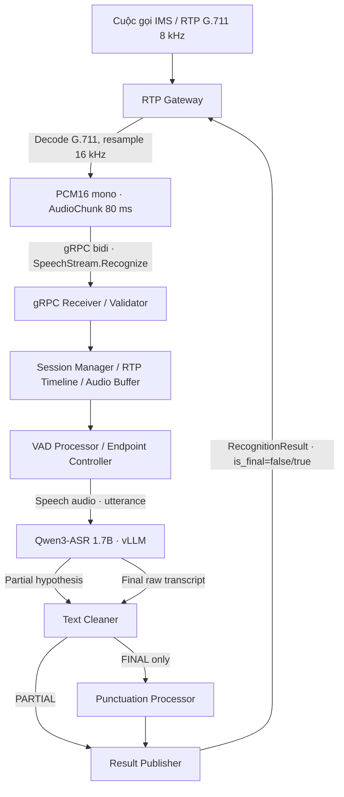
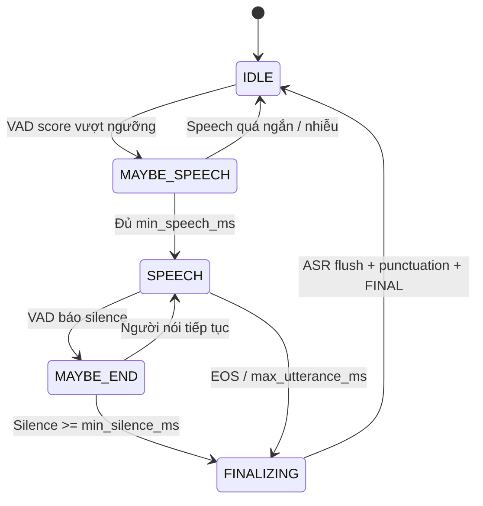
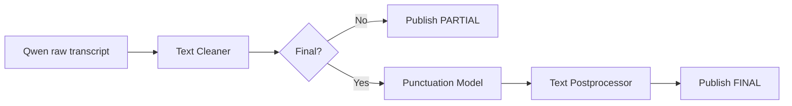
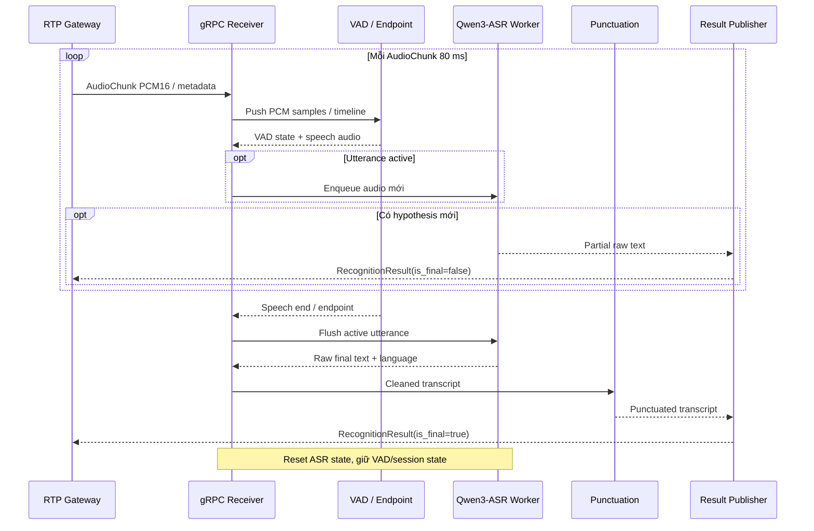

# THIẾT KẾ SPEECH ENGINE REALTIME
## VAD → Qwen3-ASR → Punctuation → gRPC RecognitionResult

> **Phiên bản:** 1.0  
> **Ngày:** 16/11/2026  
> **Đầu vào tham chiếu:** `speech(2).proto` của Gateway/Engine  
> **Phạm vi:** Nhận dạng lời nói (speech-to-text) realtime; **không** triển khai WER, Translation hoặc TTS.  
> **Lưu ý:** Những nội dung ghi **đề xuất** (thuật toán endpoint, cấu hình VAD, cách quản lý timestamp, mô hình punctuation, cơ chế scheduler) là quyết định thiết kế cần kiểm thử và chốt khi triển khai; chúng không được định nghĩa sẵn trong `speech.proto`.

---

## 1. Mục tiêu và phạm vi

### 1.1. Mục tiêu

Thiết kế một **Speech Engine** nhận luồng âm thanh từ RTP Gateway qua **gRPC bidirectional streaming**, tự động xử lý:

1. Nhận `AudioChunk` PCM16 mono 16 kHz, mỗi chunk 80 ms.
2. Quản lý từng `session_id` / `stream_id`, sequence và RTP timestamp.
3. Dùng VAD để phát hiện tiếng nói và chia thành utterance.
4. Dùng **Qwen3-ASR-1.7B** trên backend vLLM để nhận dạng từng utterance, có hỗ trợ partial hypothesis.
5. Xóa marker/phần prefix không thuộc transcript, ví dụ `language: Vietnamese<asr_text>`.
6. Sử dụng **punctuation processor** để khôi phục dấu câu cho transcript cuối cùng.
7. Trả kết quả cho client bằng `RecognitionResult` qua chính RPC streaming.

### 1.2. Ngoài phạm vi

- Không tính WER, CER hay xử lý ground truth.
- Không xây dựng translation hoặc TTS.
- Không tạo `audio_payload` trong `RecognitionResult`.
- Không decode G.711 hoặc tái tạo RTP ở Engine: RTP Gateway chịu trách nhiệm chuyển G.711 8 kHz thành PCM16 mono 16 kHz trước khi gửi Engine.

### 1.3. Nguyên tắc quan trọng

- **80 ms là kích thước gRPC AudioChunk, không phải chu kỳ bắt buộc của ASR inference.**
- **VAD/endpoint controller quyết định chốt utterance; punctuation không dùng để quyết định thời điểm COMMIT.**
- **PARTIAL** là hypothesis thay thế của utterance đang mở; **FINAL** là kết quả hoàn chỉnh của utterance sau punctuation.
- State VAD và ASR tách biệt theo từng stream; ASR state được reset **theo utterance**, không reset mỗi 80 ms.
- Receiver gRPC không chờ trực tiếp GPU inference; các bước được điều phối bất đồng bộ, có giới hạn hàng đợi và backpressure.

---

## 2. Kiến trúc tổng thể



### 2.1. Phân chia trách nhiệm

| Module | Trách nhiệm |
|---|---|
| `grpc_server` | Duy trì RPC bidirectional, nhận `AudioChunk`, phát `RecognitionResult`, xử lý cancel/half-close. |
| `request_validator` | Kiểm tra sample rate, codec hợp đồng, channels, chunk sequence, metadata, kích thước dữ liệu. |
| `session_manager` | Quản lý phiên theo `(session_id, stream_id)` và dọn tài nguyên. |
| `rtp_timing` | Chuyển vị trí mẫu âm thanh thành timeline RTP 8 kHz, phát hiện gap và wraparound. |
| `audio_buffer` | Buffer đầu vào, pre-roll, audio chưa xử lý và trạng thái bộ đệm hữu hạn. |
| `vad_processor` | Chạy VAD có state, tách frame 16 kHz riêng với chunk gRPC. |
| `endpoint_controller` | State machine nhận speech start/silence/speech end; quyết định FINAL/force split. |
| `qwen_asr_processor` | Tạo streaming state, đẩy audio mới, sinh partial, flush final. |
| `asr_scheduler` | Điều phối inference GPU và ngăn concurrent inference cùng utterance. |
| `text_cleaner` | Loại bỏ metadata ASR và chuẩn hóa văn bản an toàn. |
| `punctuation_processor` | Khôi phục dấu câu/viết hoa cho text sau khi chốt utterance. |
| `result_publisher` | Bảo toàn thứ tự, tạo `RecognitionResult`, loại bỏ partial đã lỗi thời. |

### 2.2. Gợi ý phân tách quá trình

Ở phiên bản đầu, có thể chạy gRPC service, VAD, session manager và text processor trong cùng một service Python. Inference Qwen3-ASR dùng worker/scheduler tách khỏi event loop; punctuation model được load một lần khi khởi động. Nếu khối lượng cuộc gọi tăng, có thể tách ASR worker thành một service riêng mà không thay đổi hợp đồng Gateway ↔ Engine.

---

## 3. Hợp đồng gRPC theo `speech.proto`

Giao thức **đã có**:

```protobuf
syntax = "proto3";
package speech;

service SpeechStream {
  rpc Recognize(stream AudioChunk) returns (stream RecognitionResult);
}
```

### 3.1. Trường đầu vào `AudioChunk`

| Trường protobuf | Tag | Quy định sử dụng trong thiết kế |
|---|---:|---|
| `session_id` | 1 | ID cuộc gọi IMS, ổn định trong cuộc gọi. |
| `stream_id` | 2 | ID chiều thoại, ví dụ `call-001-a2b`; một RPC xử lý một stream. |
| `pcm` | 3 | Bytes PCM16 little-endian, 16 kHz, mono (theo hợp đồng Gateway–Engine). |
| `sample_rate` | 4 | `16000`. |
| `channels` | 5 | `1`. |
| `rtp_timestamp` | 6 | `uint32`, theo clock nguồn RTP G.711 8 kHz. |
| `duration_ms` | 7 | Thông thường `80`. |
| `end_of_stream` | 8 | Khi `true`, yêu cầu flush và kết thúc stream. |
| `language` | 9 | Với `speech_to_text`: ngôn ngữ nguồn `vi`, `en` hoặc rỗng để auto. |
| `task` | 10 | `speech_to_text`; không hỗ trợ `realtime_translation` trong phạm vi này. |
| `rtp_clock_rate` | 11 | `8000`. Proto cho phép `0` để suy ra từ sample rate, nhưng với nguồn G.711 khuyến nghị luôn gửi `8000`. |
| `chunk_seq` | 12 | Số thứ tự tăng đơn điệu, 0-based; trong proto `-1` nghĩa là không cung cấp. |
| `language_source` | 13 | Gợi ý nguồn `vi`/`en`; chỉ dùng khi cấu hình `asr.use_language_source` bật. |

**Lưu ý về `chunk_seq`:** Vì kiểu `int64` trong proto3 có mặc định bằng 0, Gateway nên gửi giá trị 0-based nhất quán; khi không cung cấp phải dùng `-1` rõ ràng, không dựa vào việc field vắng mặt để phân biệt.

**Lưu ý về codec:** `pcm` là trường bytes, không có field encoding. Việc luôn gửi signed PCM16 little-endian là **hợp đồng triển khai**, cần ghi trong tài liệu Gateway và kiểm thử tích hợp.

### 3.2. Quy đổi audio 80 ms

| Thông số | Giá trị |
|---|---:|
| Sample rate PCM16 | 16.000 Hz |
| Duration / chunk | 80 ms |
| Samples / chunk | 1.280 samples |
| Bytes / chunk PCM16 mono | 2.560 bytes |
| RTP clock nguồn | 8.000 Hz |
| RTP timestamp tăng / 80 ms | 640 ticks |
| G.711 8 kHz tương ứng 80 ms | 640 bytes |

Các chunk thông thường có `rtp_timestamp` lần lượt: `T0`, `T0+640`, `T0+1280`... theo modulo `2^32`.

**Không dùng 1.280 ticks/chunk cho RTP timestamp khi clock nguồn là 8 kHz.**

### 3.3. Trường đầu ra `RecognitionResult`

| Trường protobuf | Tag | PARTIAL (`is_final=false`) | FINAL (`is_final=true`) |
|---|---:|---|---|
| `session_id` | 1 | Giữ nguyên | Giữ nguyên |
| `stream_id` | 2 | Giữ nguyên | Giữ nguyên |
| `text` | 3 | Hypothesis ASR đã clean | Transcript sau punctuation |
| `is_final` | 4 | `false` | `true` |
| `ts_start` | 5 | RTP tick bắt đầu utterance | RTP tick bắt đầu utterance |
| `ts_end` | 6 | RTP tick vị trí đã xử lý | RTP tick kết thúc lời nói |
| `confidence` | 7 | `0.0` nếu chưa có thông tin | `0.0` nếu chưa có thông tin |
| `language` | 8 | Ngôn ngữ ASR hiện tại | Ngôn ngữ cuối utterance |
| `seq` | 9 | Tăng mỗi response trong stream | Tiếp tục tăng, không reset theo utterance |
| `audio_payload` | 10 | Rỗng | Rỗng |
| `audio_pt` | 11 | Không sử dụng | Không sử dụng |

**Giới hạn của proto hiện có:** Không có `utterance_id`, `commit_reason`, `raw_text`, `revision`. Để không thay đổi API, Gateway áp dụng quy tắc tuần tự: mọi PARTIAL trước FINAL thuộc utterance đang mở; FINAL kết thúc utterance đó. Nếu cần hỗ trợ out-of-order result, retry hoặc đo lý do commit chi tiết ở tầng API, có thể đề xuất bổ sung các trường trong một phiên bản protobuf mới.

**`confidence` hiện chưa phải xác suất độ tin cậy đã hiệu chuẩn:** Qwen3-ASR không mặc định trả một confidence utterance-level chuẩn hóa. Quy ước `0.0 = unavailable` cần thống nhất với client; không suy luận rằng transcript có confidence bằng 0%.

### 3.4. Quy tắc timestamp RTP

- Mọi mốc `ts_start` và `ts_end` là **tick RTP nguồn 8 kHz**, không phải mili-giây và không phải số mẫu PCM16.
- Đề xuất thống nhất khoảng `[ts_start, ts_end)`; `ts_end` là vị trí ngay sau mẫu cuối thuộc utterance.
- Timeline nội bộ lưu timestamp đã **unwrap** thành `int64` để xử lý wraparound 32-bit.
- **Đề xuất API cần xác nhận với Gateway:** xuất `ts_start/ts_end` bằng tick đã unwrap (`int64` đơn điệu), không tự ý ép modulo 32-bit. Nếu Gateway đang kỳ vọng timestamp gốc 32-bit thì cần chốt lại trước khi tích hợp.
- VAD xác định ranh giới tiếng nói; Qwen3-ASR không cung cấp timestamp từ theo mặc định cho streaming API.

Ví dụ utterance có thời lượng 1.600 ms: `ts_end - ts_start ≈ 12.800` ticks ở 8 kHz.

---

## 4. Quản lý session và stream

### 4.1. Khóa session

```text
session_key = (session_id, stream_id)
```

- Một cuộc gọi IMS có thể có 1 hoặc 2 stream tùy yêu cầu một chiều/hai chiều.
- Với hai chiều: `(call-001, call-001-a2b)` và `(call-001, call-001-b2a)` được quản lý **độc lập**.
- Không chia sẻ state VAD, buffer, RTP timing hoặc ASR giữa hai hướng.
- `session_id` và `stream_id` phải nhất quán trong toàn bộ RPC, nếu thay đổi thì trả lỗi giao thức.

### 4.2. State cần lưu

```text
SessionState
├── session_id / stream_id
├── input_chunk_seq_expected
├── output_result_seq_next
├── rtp_unwrapper / audio_sample_cursor
├── ingress_audio_buffer / vad_frame_buffer
├── vad_model_state / endpoint_state
├── utterance_id_internal
├── utterance_start_sample / last_speech_sample
├── pre_roll_buffer / pending_silence_buffer
├── asr_streaming_state (chỉ khi utterance đang mở)
├── last_partial_text / last_partial_time
├── generation_id (chống kết quả cũ đến muộn)
└── cancellation / timeout / backpressure state
```

Punctuation model được load chung toàn Engine; **không** khởi tạo model theo session.

---

## 5. VAD và endpoint/COMMIT

### 5.1. VAD đề xuất

Dùng **Silero VAD** chạy trên frame âm thanh 16 kHz, có state theo stream.

- Chunk gRPC 80 ms chứa 1.280 samples.
- VAD có thể xử lý các frame 512 samples ở 16 kHz (32 ms) tùy API/version được chọn.
- `vad_processor` cần tích lũy liên tục và tái chia frame; **không padding từng chunk 80 ms riêng lẻ** rồi reset VAD state.
- Thời gian và timestamp được tính theo **số mẫu thực tế** trong timeline, không lấy số frame 32 ms để suy ra lại RTP timestamp nếu có phần dư trong buffer.

### 5.2. State machine



### 5.3. Tham số khởi đầu (cần điều chỉnh qua kiểm thử)

| Tham số | Giá trị đề xuất | Mục đích |
|---|---:|---|
| `vad.threshold` | `0.50` | Ngưỡng nhận speech. |
| `vad.neg_threshold` | `0.35` | Ngưỡng hysteresis chuyển về non-speech. |
| `vad.min_speech_ms` | `160` | Bỏ các nhiễu rất ngắn. |
| `vad.min_silence_ms` | `500` | Xác nhận kết thúc utterance. |
| `vad.pre_roll_ms` | `160` | Giữ tiếng trước thời điểm VAD xác nhận speech. |
| `vad.post_roll_ms` | `120` | Giữ phần đuôi audio. |
| `vad.max_utterance_ms` | `15000` | Giới hạn utterance quá dài và compute ASR. |

Đây là **giá trị ban đầu** cho thử nghiệm thoại G.711, chưa phải cấu hình đã tối ưu cho mọi môi trường ồn/tiếng Việt/tiếng Anh.

### 5.4. Quy trình COMMIT

1. **IDLE:** Nhận PCM và cập nhật rolling `pre_roll_buffer`, chưa gọi ASR.
2. **MAYBE_SPEECH:** Có dấu hiệu speech; giữ audio chờ xác nhận để không mất phần đầu câu.
3. **SPEECH_START:** Tạo utterance mới; khởi tạo ASR streaming state; nạp pre-roll và audio đã giữ đúng **một lần**.
4. **SPEECH:** VAD tiếp tục nhận frame, audio speech mới được nạp cho ASR; gửi PARTIAL theo chu kỳ inference.
5. **MAYBE_END:** Khi thấy silence, chưa COMMIT; giữ trạng thái và audio chờ, nếu người nói tiếp tục thì nối cùng utterance.
6. **SPEECH_END:** Khi silence đủ ngưỡng, xác định kết thúc speech; chỉ giữ `post_roll` thích hợp cho ASR, tránh nạp toàn bộ khoảng im lặng dư thừa.
7. **FINALIZING:** Đợi inference còn chạy, flush ASR, làm sạch transcript, punctuation, phát một FINAL; rồi giải phóng ASR state utterance.
8. Quay lại IDLE và tiếp tục tiếp nhận AudioChunk của cuộc gọi.

**Quy tắc bảo đảm:** Mỗi đoạn audio thuộc utterance chỉ được nạp vào ASR **một lần**; không được gửi lại phần pre-roll hoặc audio đang pending khi VAD chuyển `MAYBE_END → SPEECH`.

### 5.5. Forced split cho utterance dài

- Khi đến `max_utterance_ms`, tìm khoảng lặng gần nhất hợp lệ để chốt câu.
- Nếu không có silence, forced split ở ranh giới được xác định trước; chốt ASR state cũ, tạo state mới và chuyển tiếp audio sau ranh giới.
- Có thể cân nhắc overlap ngắn để tránh mất âm tiết nhưng phải có cơ chế khử trùng lặp; **không bật overlap mặc định** nếu chưa có logic chống lặp.
- Punctuation có thể thêm dấu ở ranh giới này, song không được mặc định suy diễn rằng người nói đã kết thúc câu ngữ pháp.

---

## 6. Qwen3-ASR và chu kỳ inference

### 6.1. Backend

- Model: `Qwen/Qwen3-ASR-1.7B` hoặc bản model lưu nội bộ tương ứng.
- Backend: vLLM qua adapter `qwen_asr` nếu phiên bản cài đặt hỗ trợ streaming API.
- Khởi tạo model một lần khi Engine/worker startup, **không** load theo call.
- Mỗi utterance có **streaming state** riêng; không dùng chung state giữa các cuộc gọi.

### 6.2. Tách thời gian nhận audio khỏi inference

| Chu kỳ | Giá trị khởi đầu | Ý nghĩa |
|---|---:|---|
| Gateway → Engine | 80 ms | Mỗi `AudioChunk` gửi qua gRPC. |
| VAD internal frame | Theo API VAD, ví dụ 32 ms | Cập nhật speech probability liên tục. |
| ASR streaming inference | 1,0 giây | Cập nhật PARTIAL khi tích lũy đủ audio. |
| VAD silence endpoint | 500 ms | Chốt utterance. |
| Final ASR + punctuation | Ngay khi endpoint | Flush phần cuối để tạo FINAL. |

**Quan trọng:** Trong triển khai Qwen3-ASR streaming upstream, mỗi lần inference có thể tái sử dụng toàn bộ audio tích lũy của utterance cùng cơ chế rollback token, **không đồng nghĩa** với incremental audio inference chỉ xử lý 1 giây audio mới. Do đó cần kiểm soát số lần inference và độ dài utterance.

### 6.3. ASR adapter (pseudocode)

```python
class QwenASRAdapter:
    def start_utterance(self, language: str | None):
        # Tạo streaming state riêng cho utterance
        # Ví dụ: init_streaming_state(language=..., chunk_size_sec=1.0, ...)
        ...

    async def push_audio(self, pcm16k_samples):
        # Đưa dữ liệu audio MỚI vào state đúng một lần
        # Scheduler chỉ cho một inference đang chạy trên utterance
        ...

    async def get_partial(self) -> tuple[str, str | None]:
        # Đọc hypothesis sau khi có inference cập nhật
        ...

    async def finish(self) -> tuple[str, str | None]:
        # Hoàn tất audio cuối còn trong buffer
        # Trả raw_text, detected_language
        ...

    def reset(self):
        # Giải phóng state utterance, không giải phóng model dùng chung
        ...
```

*Pseudocode mô tả hợp đồng module, không phải mã có thể chạy ngay. Tên hàm/kiểu trả về của `qwen_asr` cần kiểm tra theo phiên bản SDK đang cài đặt.*

### 6.4. Concurrency và GPU

- Không chạy inference đồng thời cho cùng một utterance.
- gRPC receiver chỉ enqueue audio và nhận kết quả worker, không block event loop do inference đồng bộ.
- Scheduler có giới hạn hàng đợi và thời gian chờ; một stream đang chậm không được làm mất thứ tự result của chính stream đó.
- Khi inference chậm hơn thời gian thực kéo dài, phải áp dụng chính sách backpressure/overload; không cho audio buffer tăng vô hạn.
- Tùy khả năng thực tế của vLLM/wrapper, có thể batch nhiều utterance từ nhiều call; cần kiểm chứng hỗ trợ concurrency của SDK.

---

## 7. Text cleaner và punctuation

### 7.1. Luồng xử lý text



Ví dụ:

```text
ASR raw:    language: Vietnamese<asr_text>xin chào tổng đài tôi muốn kiểm tra tài khoản
Cleaned:    xin chào tổng đài tôi muốn kiểm tra tài khoản
Punctuated: Xin chào tổng đài, tôi muốn kiểm tra tài khoản.
```

### 7.2. Text Cleaner

- Loại bỏ **metadata** do ASR sinh ra: `language: Vietnamese<asr_text>`, `<asr_text>` và marker được nhận diện rõ.
- Chuẩn hóa khoảng trắng và ký tự điều khiển không cần thiết.
- Không tự đổi/sửa từ mà ASR nhận dạng.
- Chỉ clean **bản sao transcript để hiển thị**; không can thiệp state nội bộ hoặc prompt rollback token của Qwen.

### 7.3. Punctuation Processor

- Model punctuation load một lần, dùng được cho các ngôn ngữ cần hỗ trợ (ví dụ `vi`, `en`).
- Chạy mặc định khi utterance đã FINAL, không chạy cho PARTIAL.
- Nhiệm vụ: khôi phục dấu `,`, `.`, `?`, `!` (nếu được hỗ trợ), viết hoa hợp lý.
- Không thêm/bớt nội dung từ vựng; trường hợp cần biên tập từ phải là chức năng riêng, không gộp chung punctuation.
- Khi punctuation model lỗi hoặc timeout: **fallback về text đã clean**, vẫn phát FINAL để không giữ stream vô thời hạn.
- Model/implementation punctuation cụ thể là quyết định triển khai tiếp theo; chưa chỉ định model trong `speech.proto`.

### 7.4. Chế độ output đề xuất

| Chế độ | PARTIAL | FINAL |
|---|---|---|
| `final_only` | Không gửi | Có punctuation |
| **`partial_raw_final_punctuated`** (mặc định) | ASR text đã clean | Có punctuation |
| `partial_punctuated` | Có punctuation nhưng dễ thay đổi | Có punctuation |

Khuyến nghị chọn `partial_raw_final_punctuated` cho ứng dụng realtime. Nếu Gateway không cần hiển thị nội dung tạm, có thể cấu hình `final_only`.

---

## 8. Quy tắc phát RecognitionResult

### 8.1. PARTIAL

- Sinh ra sau mỗi inference có thay đổi đáng kể so với hypothesis trước.
- Không gửi dày hơn `partial_min_interval_ms`, ví dụ 800 ms (đề xuất).
- `text` là **toàn bộ** hypothesis hiện tại của utterance, không phải diff token.
- Gateway thay thế PARTIAL trước, không append PARTIAL vào transcript đã chốt.
- Cần gắn `generation_id` nội bộ để loại bỏ partial từ tác vụ inference cũ đến sau FINAL.

### 8.2. FINAL

- Chỉ sinh sau khi endpoint controller xác nhận chốt utterance, ASR flush xong và punctuation đã xử lý/fallback.
- FINAL được append vào transcript phía Gateway.
- Không gửi FINAL rỗng cho khoảng silence nếu không có từ được nhận dạng.
- Mỗi utterance tối đa một FINAL theo giao thức một chiều/không retry hiện tại.
- FINAL phải đi sau PARTIAL tương ứng và trước PARTIAL của utterance tiếp theo trên cùng một stream.

### 8.3. Ví dụ diễn tiến

| Thời điểm | Sự kiện | `is_final` | `text` |
|---|---|---|---|
| T1 | ASR partial 1 | `false` | `xin chào tổng đài` |
| T2 | ASR partial 2 | `false` | `xin chào tổng đài tôi muốn kiểm tra` |
| T3 | VAD xác nhận speech end, ASR flush, punctuation | `true` | `Xin chào tổng đài, tôi muốn kiểm tra tài khoản.` |
| T4 | Silence | — | Không gửi result |

---

## 9. Luồng xử lý chi tiết

### 9.1. Sequence diagram



### 9.2. Pseudocode điều phối

```python
async def on_audio_chunk(chunk, session):
    validate_audio_chunk(chunk, session)
    session.update_sequence_and_timing(chunk)

    events = session.segmenter.push_pcm(
        pcm=chunk.pcm,
        rtp_timestamp=chunk.rtp_timestamp,
    )

    for event in events:
        if event.kind == "SPEECH_START":
            session.start_utterance(event.start_rtp)

        elif event.kind == "SPEECH_AUDIO":
            # Enqueue audio mới, không nạp lại pre-roll hay pending audio
            await session.asr.enqueue(event.new_audio)

        elif event.kind == "SPEECH_END":
            await finalize_active_utterance(session, event)

    if chunk.end_of_stream:
        await session.segmenter.flush_pending()
        await session.flush_active_utterance()
        await session.close()


async def finalize_active_utterance(session, event):
    await session.asr.drain()
    raw_text, language = await session.asr.finish()

    cleaned = clean_asr_text(raw_text)
    if cleaned.strip():
        try:
            final_text = await session.punctuation.restore(
                cleaned, language=language
            )
        except Exception:
            final_text = cleaned  # fallback có kiểm soát

        await session.publisher.publish_final(
            text=final_text,
            language=language,
            ts_start=event.start_rtp,
            ts_end=event.end_rtp,
        )

    session.reset_utterance_asr()
```

*Pseudocode mang tính kiến trúc. Khi hiện thực, `segmenter.flush_pending()` phải đưa ra các event còn lại trước khi `flush_active_utterance()` chạy; cần kiểm soát race condition giữa reader, inference worker và publisher.*

---

## 10. Cấu hình tham chiếu

```yaml
server:
  grpc:
    host: "0.0.0.0"
    port: 50051
    max_concurrent_streams: 50  # Giá trị khởi đầu, chưa benchmark
    stream_idle_timeout_sec: 30

audio:
  sample_rate: 16000
  channels: 1
  encoding: pcm_s16le
  chunk_ms: 80
  rtp_clock_rate: 8000

vad:
  enabled: true
  backend: silero
  threshold: 0.50
  neg_threshold: 0.35
  min_speech_ms: 160
  min_silence_ms: 500
  pre_roll_ms: 160
  post_roll_ms: 120
  max_utterance_ms: 15000

asr:
  backend: vllm
  model: /models/Qwen3-ASR-1.7B
  use_language_source: true
  chunk_size_sec: 1.0
  unfixed_chunk_num: 2
  unfixed_token_num: 5
  gpu_memory_utilization: 0.8
  max_new_tokens: 128

punctuation:
  enabled: true
  backend: local_model
  model_path: /models/punctuation  # Placeholder
  languages: [vi, en]
  apply_on_partial: false
  apply_on_final: true
  on_error: fallback_cleaned_text

output:
  send_partial: true
  partial_only_on_change: true
  partial_min_interval_ms: 800
  final_after_punctuation: true
  strip_asr_markers: true

logging:
  log_vad_events: true
  log_vad_score: true
  log_partial_text: true
  log_final_text: true
  log_inference_latency: true
  log_commit_latency: true
```

**Phân biệt:** `speech.proto` chỉ mô tả hợp đồng Gateway–Engine. Các key trong YAML là **đề xuất cấu hình**, cần được hiện thực bởi code Engine. `max_concurrent_streams=50` không thể coi là năng lực GPU đã được chứng minh. Các đường dẫn model chỉ là ví dụ vị trí triển khai offline.

---

## 11. Xử lý lỗi và tính bền vững

| Tình huống | Chính sách đề xuất |
|---|---|
| `sample_rate != 16000` hoặc `channels != 1` | Trả `INVALID_ARGUMENT` hoặc hỗ trợ resample có kiểm soát nếu sau này mở rộng; mặc định reject. |
| `pcm` sai kích thước thông thường | Chấp nhận chunk cuối ngắn nếu có quy định; kiểm tra duration thực theo bytes/sample rate, không mù quáng tin `duration_ms`. |
| `chunk_seq` gián đoạn / out-of-order | Ghi log, phát hiện discontinuity; không tự âm thầm nối các thời điểm thành audio liên tục. |
| RTP timestamp wraparound | Unwrap timeline nội bộ, giữ đúng clock 8 kHz. |
| Mất RTP/packet loss | Gateway ưu tiên jitter/PLC; Engine đánh dấu discontinuity và áp dụng chính sách audio gap được thống nhất. |
| Client kết thúc stream giữa câu | Flush VAD, ASR, punctuation; gửi FINAL nếu có transcript; đóng sau khi drain response. |
| Client cancel đột ngột | Hủy tác vụ chờ, giải phóng session/buffer và các inference không cần thiết. |
| VAD silence ngắn giữa câu | Trở lại SPEECH, giữ nguyên ASR state. |
| Utterance quá dài | Forced split có kiểm soát, hạn chế mất/lặp audio. |
| Punctuation timeout/lỗi | Fallback text đã clean, vẫn phát FINAL. |
| ASR timeout/lỗi | Trả trạng thái RPC phù hợp, ghi log có correlation; không giả tạo transcript FINAL. |
| GPU bị quá tải | Hàng đợi hữu hạn, backpressure, timeout và chính sách từ chối khi vượt tài nguyên. |
| PARTIAL đến muộn sau FINAL | Loại bỏ bằng generation/utterance token nội bộ. |
| Nhiều stream đồng thời | Isolation state, sequence và timestamp theo `(session_id, stream_id)`. |

### 11.1. Kết thúc stream

Có hai tình huống cần thống nhất:

1. Gateway gửi chunk có `end_of_stream=true`: Engine xử lý audio trong chunk (nếu có), flush và gửi FINAL trước khi đóng chiều response.
2. Gateway half-close request stream bình thường mà không gửi EOS: Engine cũng cần thực hiện flush tương đương nếu chưa bị cancel.

Nếu Gateway hủy RPC (cancel/connection lost), không thể đảm bảo FINAL tới client; Engine chỉ cần dọn tài nguyên đúng cách.

### 11.2. Bảo mật tối thiểu

Trong lab nội bộ có thể sử dụng gRPC plaintext. Trong mạng production nên bổ sung TLS/mTLS hoặc kiểm soát kết nối tương đương, giới hạn message size và quyền truy cập, đồng thời cấu hình log để không lưu dữ liệu thoại/transcript nhạy cảm quá mức cần thiết.

---

## 12. Kiểm thử nghiệm thu chức năng (không có WER)

| ID | Test case | Kết quả cần đạt |
|---|---|---|
| TC01 | Một câu rồi im lặng ≥500 ms | Một FINAL có punctuation; đúng thứ tự. |
| TC02 | Ngập ngừng 200–300 ms giữa câu | Không COMMIT sớm; cùng utterance. |
| TC03 | Hai câu cách nhau 800 ms silence | Hai FINAL, mỗi câu một utterance. |
| TC04 | Audio toàn silence | Không có transcript/FINAL rỗng. |
| TC05 | Từ ngắn: “dạ”, “vâng”, “có” | VAD không cắt mất tiếng khi cấu hình phù hợp. |
| TC06 | EOS giữa câu | Flush ra FINAL (nếu có speech/text). |
| TC07 | Raw text có `language: Vietnamese<asr_text>` | Marker không xuất hiện ở text trả client. |
| TC08 | ASR cập nhật partial nhiều lần | Gateway thay thế partial cũ, không nhân bản từ. |
| TC09 | Punctuation lỗi/timeout | Fallback cleaned text, vẫn FINAL. |
| TC10 | GPU inference chậm | gRPC không bị block vô hạn, có backpressure. |
| TC11 | 10–50 stream đồng thời | Không lẫn session, hypothesis, timestamp; năng lực thực tế đo theo GPU. |
| TC12 | RTP timestamp gần `2^32-1` | Timestamp xử lý wraparound đúng. |
| TC13 | Mất/đảo `chunk_seq` | Phát hiện discontinuity, không âm thầm coi là audio bình thường. |
| TC14 | Client cancel RPC | Release state và dọn tác vụ. |
| TC15 | Một utterance >15 giây | Forced split theo chính sách, không rò bộ nhớ. |
| TC16 | Stream A2B và B2A cùng `session_id` | State độc lập theo `stream_id`. |

### 12.1. Chỉ số vận hành cần log

**Không đánh giá WER**. Chỉ đo các chỉ số phục vụ xử lý realtime:

- Số chunk nhận, chunk mất/sai sequence, độ dài audio buffer.
- VAD score, speech start/end, thời gian silence trước COMMIT.
- Độ dài utterance, tỷ lệ forced split.
- Số lần gọi ASR inference / utterance và latency inference.
- Thời gian từ **speech end → FINAL** (commit latency).
- Punctuation latency và tỷ lệ fallback.
- Số stream hoạt động, hàng đợi GPU, timeouts, canceled streams, process VRAM/GPU utilization.

---

## 13. Tổ chức source code đề xuất

```text
speech-engine/
├── server.py
├── speech.proto
├── config.yaml
├── grpc/
│   ├── speech_service.py
│   ├── request_validator.py
│   └── result_publisher.py
├── core/
│   ├── session_manager.py
│   ├── audio_buffer.py
│   ├── rtp_timing.py
│   ├── utterance_segmenter.py
│   └── endpoint_controller.py
├── processors/
│   ├── vad_processor.py
│   ├── qwen_asr_processor.py
│   ├── text_cleaner.py
│   └── punctuation_processor.py
├── workers/
│   ├── asr_scheduler.py
│   └── punctuation_worker.py
├── tests/
│   ├── test_grpc_stream.py
│   ├── test_vad_commit.py
│   ├── test_asr_state.py
│   ├── test_punctuation.py
│   └── test_multisession.py
└── requirements.txt
```

---

## 14. Các quyết định cần chốt trước khi code

| Nội dung | Đề xuất mặc định | Cần xác nhận |
|---|---|---|
| Ngôn ngữ đầu vào | `vi`, `en`, hoặc auto | Hợp đồng language và `language_source` với Gateway. |
| Audio payload | PCM16 little-endian 16 kHz mono | Gateway bảo đảm decode G.711 + resample. |
| Phạm vi RPC | 1 `stream_id` / RPC | Nếu Gateway multiplex nhiều stream thì phải sửa session-routing. |
| Output | `partial_raw_final_punctuated` | Client có cần PARTIAL không. |
| Endpoint silence | 500 ms | Mức trễ chấp nhận trong thoại thực tế. |
| ASR chunk | 1.0 s | Năng lực GPU và tính năng wrapper/vLLM thực tế. |
| `ts_start`/`ts_end` | Tick RTP đã unwrap, `[start,end)` | Gateway có chấp nhận extended timestamp 64-bit hay không. |
| Punctuation model | Model local cho `vi/en` | Lựa chọn model và kiểm thử chi phí/latency. |
| ASR lỗi/timeout | Trả lỗi rõ ràng, không sinh FINAL giả | Chính sách reconnect/retry Gateway. |
| High load | Buffer hữu hạn, backpressure | Mức đồng thời/độ trễ SLO sau benchmark. |

---

## 15. Kết luận

Thiết kế sử dụng nguyên giao thức **`SpeechStream.Recognize(stream AudioChunk) returns (stream RecognitionResult)`**, với chuỗi xử lý:

```text
Gateway PCM16/16k/80ms
  → gRPC Receiver / Session Manager
  → VAD (speech start/end, pre-roll, endpoint)
  → Qwen3-ASR Streaming (PARTIAL / flush FINAL)
  → Text Cleaner
  → Punctuation (FINAL)
  → RecognitionResult.text cho Gateway
```

**Ưu tiên triển khai:** (1) VAD + utterance buffering không mất/lặp audio; (2) quản lý Qwen streaming state theo utterance và concurrency; (3) punctuation cho FINAL với fallback; (4) trả `RecognitionResult` đúng thứ tự và RTP timestamp. Chức năng này **không cần** WER, translation hay TTS.

### Tài liệu tham chiếu

- **Nguồn chính được cung cấp:** `speech(2).proto` — package `speech`, RPC `SpeechStream.Recognize`, cấu trúc `AudioChunk` và `RecognitionResult`.
- **Thiết kế đối chiếu với bộ code đã thảo luận:** `qwen3_asr_eval_dual_wer.zip` — chỉ tham khảo phần client gRPC và text-cleaning; không sử dụng thành phần đánh giá WER.
- **API upstream cần kiểm tra đúng phiên bản khi hiện thực:** [Qwen3-ASR GitHub](https://github.com/QwenLM/Qwen3-ASR), [Silero VAD GitHub](https://github.com/snakers4/silero-vad).
