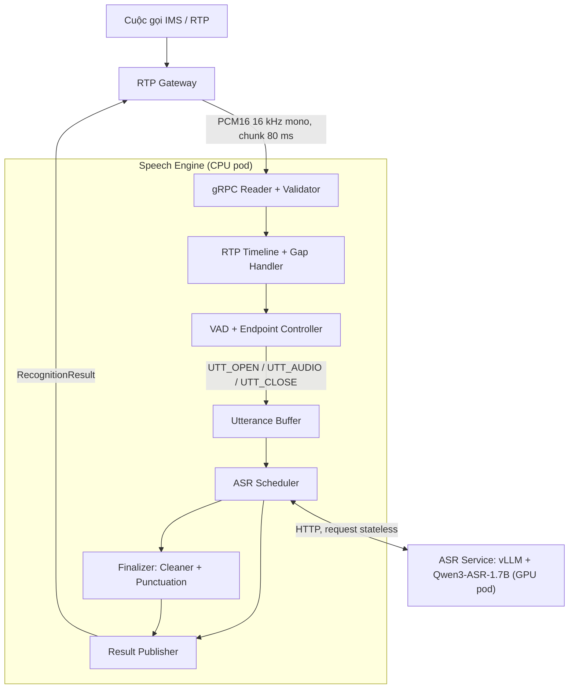
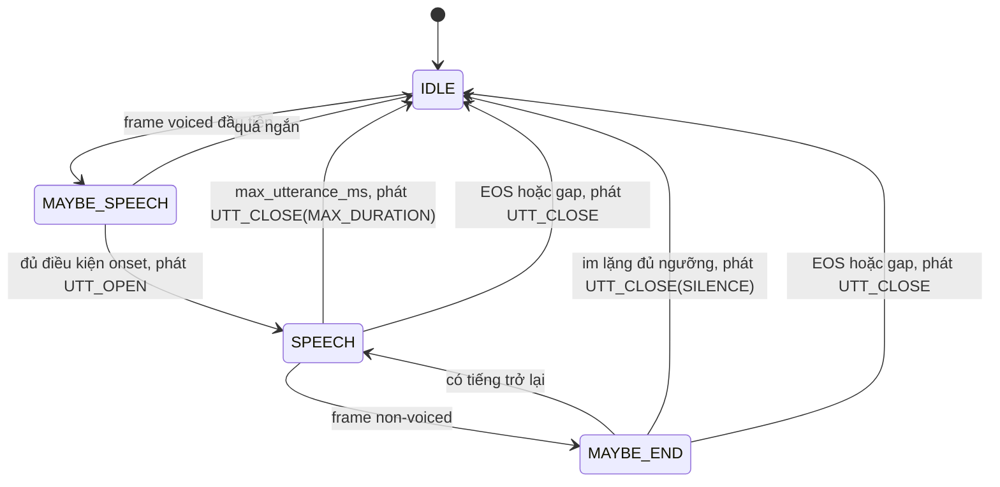
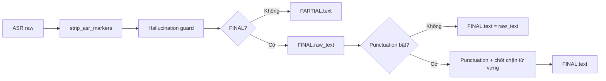
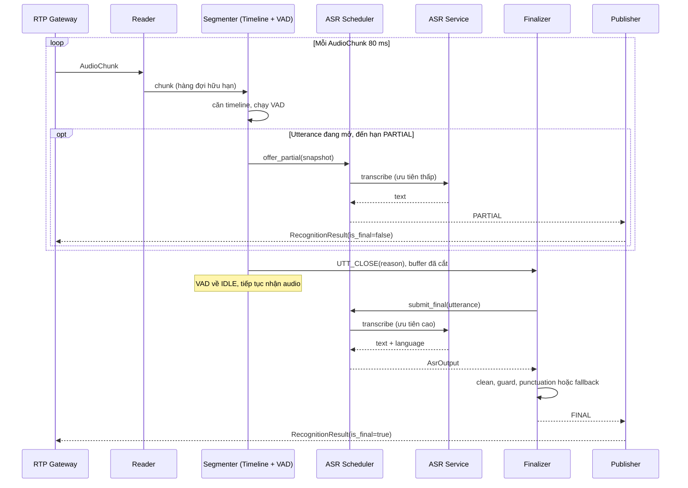

# THIẾT KẾ SPEECH ENGINE REALTIME
## VAD → Qwen3-ASR → Punctuation → gRPC RecognitionResult

> **Phiên bản:** 1.1, cập nhật lần 2 sau khi đọc code server hiện có (thay thế 1.0)  
> **Ngày:** 16/11/2026  
> **Đầu vào tham chiếu:** `docs/speech.proto`, `docs/speech_v1_1_proposed.proto`, `docs/qwen3_asr_grpc_vad_commit.zip` (server hiện có), `docs/qwen3_asr_eval_dual_wer.zip` (client đo WER)  
> **Lưu ý (16/11/2026):** hợp đồng gRPC đã hiện thực nằm ở `asr_server/README.md`, mục "gRPC contract", và `Giai_phap_fix_bug_server_hien_tai.md` mục 13. Mục 3 của tài liệu này viết trước các quyết định đó; chỗ nào khác thì README đúng.  
> **Phạm vi:** nhận dạng lời nói (`task = speech_to_text`) realtime; không triển khai translation và TTS.  
> **Quy ước:** *Đề xuất* = giá trị khởi đầu, phải đo rồi mới chốt. *Cần xác nhận* = phụ thuộc thỏa thuận với Gateway. Con số không gắn nhãn là suy ra từ proto, từ phép tính, hoặc lấy từ nguồn được dẫn ở mục 16.

---

## 0. Thay đổi so với bản 1.0

| # | Nội dung | Bản 1.0 | Bản 1.1 | Mục |
|---|---|---|---|---|
| 1 | Im lặng do DTX / mất gói | Đếm silence theo sample nhận được; chính sách gap để ngỏ | Timeline theo RTP, chèn silence theo gap, thêm timer wall-clock, lý do chốt `AUDIO_GAP` | 4.3 |
| 2 | Chế độ ASR | Streaming state của SDK `qwen_asr` chạy trong tiến trình Engine | Hai backend sau một interface: `sdk_streaming` (code server hiện có, làm baseline ở bước 1) và `offline_segment` (ASR là service `vllm serve` riêng, FINAL offline trên cả utterance, PARTIAL bỏ được; là đích đề xuất, chốt bằng số đo) | 6 |
| 3 | Finalize | Nằm trong state machine VAD, receiver `await` GPU | VAD về IDLE ngay khi endpoint; finalize là stage riêng, publisher giữ thứ tự | 5.3, 9 |
| 4 | PARTIAL không được đóng | Không gửi FINAL rỗng | Đã gửi PARTIAL thì bắt buộc có FINAL cùng `utterance_id`, kể cả rỗng hoặc lỗi | 3.4 |
| 5 | Punctuation | Model riêng, chưa chỉ định | Dùng lại `HFPunctuator` của server hiện có: chỉ chèn dấu ở ranh giới từ, giữ dấu ASR đã sinh, không đổi từ; tắt được bằng config | 7.3 |
| 6 | Proto | Dùng nguyên `speech.proto` | Thêm 5 trường tag 12–16 vào `RecognitionResult`, tương thích ngược | 3.3 |
| 7 | Text cleaner | Mô tả chung | Dùng `strip_asr_markers` đã có; marker có thể nằm giữa utterance | 7.2 |
| 8 | Quá tải | "Backpressure" chưa định nghĩa | Bậc thang hạ cấp 4 mức, ưu tiên FINAL, từ chối stream mới | 10.1 |
| 9 | Lỗi ASR | Trả RPC status, đóng stream | Báo theo từng utterance qua `status`, stream vẫn mở | 10.2 |
| 10 | Vai trò VAD | Ngầm định | Nêu rõ vì sao vẫn cần VAD khi ASR đã streaming và có dấu câu | 5.1 |
| 11 | Vận hành | Chỉ có log | Triển khai K8s, readiness, graceful drain, metrics Prometheus, log không ghi transcript mặc định | 12 |
| 12 | Đánh giá | "Không WER" | Engine không tính WER nhưng xuất `raw_text`; eval client đã có được port sang `speech.proto` | 13.2 |
| 13 | VAD mặc định | Silero | WebRTC VAD với tham số của server hiện có; Silero là ứng viên A/B | 5.2, 5.4 |
| 14 | Chốt sớm theo dấu câu | Không có | Giữ cơ chế `semantic_pause` đã có, mặc định tắt; thêm lý do chốt `SEMANTIC_PAUSE` | 5.7 |
| 15 | Tái dùng code | Không đề cập | Bảng tái dùng từ server hiện có và danh sách lỗi không được mang sang | 14.1, 14.2 |

---

## 1. Mục tiêu và phạm vi

### 1.1. Mục tiêu

Speech Engine nhận luồng âm thanh từ RTP Gateway qua gRPC bidirectional streaming và:

1. Nhận `AudioChunk` PCM16 mono 16 kHz, mỗi chunk 80 ms.
2. Quản lý từng `(session_id, stream_id)`, sequence và timeline RTP, kể cả khi audio gián đoạn.
3. Dùng VAD để tách utterance và quyết định thời điểm chốt.
4. Gọi Qwen3-ASR-1.7B (service vLLM) để sinh PARTIAL trong lúc nói và FINAL khi chốt.
5. Loại marker của model, tùy chọn khôi phục dấu câu cho FINAL.
6. Trả `RecognitionResult` đúng thứ tự, có `utterance_id`, timestamp RTP và trạng thái lỗi theo utterance.

### 1.2. Ngoài phạm vi

- Engine không tính WER/CER. Engine chỉ xuất `raw_text` để eval client tính (mục 13.2).
- Không translation, không TTS; `audio_payload` và `audio_pt` luôn rỗng.
- Không decode codec thoại và không tái tạo RTP: Gateway chịu trách nhiệm decode và resample về PCM16 mono 16 kHz.

### 1.3. Nguyên tắc

- 80 ms là kích thước chunk gRPC, không phải chu kỳ inference.
- VAD/endpoint quyết định chốt utterance. Dấu câu không quyết định thời điểm chốt (chỉ có thể rút ngắn ngưỡng im lặng, mục 5.7).
- PARTIAL là hypothesis thay thế của utterance đang mở. FINAL là kết quả duy nhất và cuối cùng của utterance.
- Luồng nhận audio không bao giờ chờ GPU. Mọi lời gọi ASR và punctuation chạy ở stage riêng, có deadline.
- State của cuộc gọi chỉ nằm trong Engine. Ở chế độ `offline_segment`, ASR không giữ state giữa các request; ở `sdk_streaming`, state ASR sống theo utterance và bị hủy khi utterance đóng.
- Audio của utterance đang mở không bao giờ bị bỏ để giảm tải; thứ bị bỏ trước là PARTIAL.

---

## 2. Kiến trúc tổng thể

### 2.1. Sơ đồ



Sơ đồ vẽ theo chế độ `offline_segment`. Ở chế độ `sdk_streaming`, khối ASR nằm trong tiến trình Engine và Engine cần GPU.

### 2.2. Phân chia trách nhiệm

| Module | Trách nhiệm |
|---|---|
| `grpc_server` | Duy trì RPC bidi, nhận `AudioChunk`, phát `RecognitionResult`, xử lý cancel/half-close, admission control. |
| `request_validator` | Kiểm tra sample rate, channels, kích thước PCM, `rtp_clock_rate`, tính nhất quán `session_id`/`stream_id`/`task`. |
| `rtp_timeline` | Unwrap RTP 32-bit, ánh xạ sample ↔ tick, phát hiện gap, chèn silence, timer wall-clock. |
| `vad_processor` | Chạy VAD có state theo stream, tái chia frame độc lập với chunk 80 ms. |
| `endpoint_controller` | State machine speech/silence; phát event mở, nối, đóng utterance kèm lý do. |
| `utterance_buffer` | Giữ PCM của utterance đang mở (pre-roll + speech + post-roll), giới hạn bởi `max_utterance_ms`. |
| `asr_client` | Gọi ASR service: một request = một đoạn audio, không state. |
| `asr_scheduler` | Giới hạn số request đồng thời, ưu tiên FINAL, gộp/bỏ PARTIAL, deadline. |
| `text_cleaner` | `strip_asr_markers` và chuẩn hóa khoảng trắng. |
| `hallucination_guard` | Phát hiện lặp, giới hạn token theo thời lượng. |
| `punctuation_processor` | Tùy chọn; khôi phục dấu câu cho FINAL, có chốt chặn đổi từ vựng. |
| `result_publisher` | Bảo toàn thứ tự theo utterance, gán `seq`/`revision`, loại PARTIAL lỗi thời. |
| `metrics` | Xuất Prometheus. |

### 2.3. Phân tách tiến trình

Cấu trúc tiến trình phụ thuộc backend ASR (mục 6.1):

| Backend | Tiến trình | Ghi chú |
|---|---|---|
| `sdk_streaming` (bước 1) | Một tiến trình Engine giữ model trên GPU, như server hiện có | Mọi lời gọi model đi qua **một worker thread duy nhất**; không dùng `asyncio.Lock` kèm `to_thread` (mục 14.2). |
| `offline_segment` (đích đề xuất) | Engine (CPU) và ASR Service (`vllm serve`, GPU) là hai deployment | Restart Engine không phải load lại model; vLLM tự gom batch; scale CPU và GPU độc lập. |

Trong cả hai trường hợp, mỗi stream là một nhóm task độc lập; lỗi của một stream không ảnh hưởng stream khác. Model punctuation load một lần cho toàn Engine.

---

## 3. Hợp đồng gRPC

```protobuf
service SpeechStream {
  rpc Recognize(stream AudioChunk) returns (stream RecognitionResult);
}
```

Một RPC phục vụ đúng một `(session_id, stream_id)`. *Cần xác nhận* với Gateway.

### 3.1. `AudioChunk` (giữ nguyên)

| Trường | Tag | Kiểu | Quy định |
|---|---:|---|---|
| `session_id` | 1 | string | ID cuộc gọi IMS, không đổi trong RPC. |
| `stream_id` | 2 | string | ID chiều thoại, ví dụ `call-001-a2b`; không đổi trong RPC. |
| `pcm` | 3 | bytes | PCM16 signed little-endian, mono. Proto không có trường encoding nên đây là hợp đồng triển khai. |
| `sample_rate` | 4 | int32 | Bắt buộc `16000`. Giá trị khác → `INVALID_ARGUMENT`. |
| `channels` | 5 | int32 | Bắt buộc `1`. |
| `rtp_timestamp` | 6 | uint32 | Timestamp RTP của mẫu đầu chunk, theo clock nguồn. |
| `duration_ms` | 7 | int64 | Thông thường `80`. Engine tính thời lượng thật từ `len(pcm)`, chỉ dùng trường này để đối chiếu. |
| `end_of_stream` | 8 | bool | `true` → xử lý audio trong chunk, flush, đóng. |
| `language` | 9 | string | Ngôn ngữ nguồn `vi`/`en`. Rỗng → dùng `asr.default_language` (mục 6.7). |
| `task` | 10 | string | Bắt buộc `speech_to_text`. `realtime_translation` → `UNIMPLEMENTED`. |
| `rtp_clock_rate` | 11 | uint32 | Clock RTP nguồn, ví dụ `8000` với G.711. **Engine từ chối `0`**: proto định nghĩa 0 là suy ra từ `sample_rate` (16000), sai với nguồn narrowband. |
| `chunk_seq` | 12 | int64 | Tăng đơn điệu, bắt đầu từ 0; `-1` = không cung cấp. |
| `language_source` | 13 | string | Gợi ý ngôn ngữ nguồn; chỉ dùng khi `asr.use_language_source` bật, khi đó ghi đè `language`. |

`language` và `language_source` được **chốt tại thời điểm mở utterance**; thay đổi giữa utterance có hiệu lực từ utterance kế tiếp.

### 3.2. Quy đổi cho chunk 80 ms, nguồn G.711

| Thông số | Giá trị |
|---|---:|
| Samples / chunk (16 kHz) | 1.280 |
| Bytes / chunk (PCM16 mono) | 2.560 |
| RTP tick / chunk (clock 8 kHz) | 640 |

Công thức tổng quát: `tick = samples × rtp_clock_rate / sample_rate`. Engine không dùng hằng số 8000 trong code để sau này nhận được nguồn băng rộng (AMR-WB, EVS, clock 16000) mà không sửa timeline.

**Lưu ý chất lượng:** nếu cuộc gọi gốc là AMR-WB/EVS mà Gateway transcode xuống G.711 rồi upsample thì mất phần băng rộng. Gateway nên decode thẳng codec gốc ra PCM 16 kHz khi có thể. *Cần xác nhận.*

**Resample ở Gateway phải có state:** bộ resample chạy liên tục qua các chunk (server hiện có dùng `soxr` chất lượng HQ theo kiểu stream). Resample độc lập từng chunk 80 ms tạo gián đoạn ở biên chunk và làm giảm độ chính xác. *Cần xác nhận.*

### 3.3. `RecognitionResult` (bổ sung tag 12–16)

| Trường | Tag | Kiểu | PARTIAL | FINAL |
|---|---:|---|---|---|
| `session_id`, `stream_id` | 1, 2 | string | Giữ nguyên | Giữ nguyên |
| `text` | 3 | string | Hypothesis đã clean | Transcript cuối (sau punctuation nếu bật) |
| `is_final` | 4 | bool | `false` | `true` |
| `ts_start` | 5 | int64 | Tick RTP bắt đầu utterance | Như PARTIAL |
| `ts_end` | 6 | int64 | Tick RTP của audio đã đưa vào hypothesis | Tick RTP kết thúc lời nói |
| `confidence` | 7 | float | `0.0` = không có | `0.0` = không có |
| `language` | 8 | string | Ngôn ngữ ASR trả về | Ngôn ngữ của utterance |
| `seq` | 9 | uint64 | Tăng mỗi message trong stream | Tiếp tục tăng |
| `audio_payload`, `audio_pt` | 10, 11 | bytes, uint32 | Rỗng | Rỗng |
| **`utterance_id`** | 12 | uint64 | Tăng dần trong stream, bắt đầu từ 1 | Cùng giá trị với PARTIAL của utterance |
| **`revision`** | 13 | uint32 | Tăng dần trong utterance, bắt đầu từ 1 | Revision cuối + 1 |
| **`raw_text`** | 14 | string | Rỗng | Text đã strip marker, trước punctuation |
| **`reason`** | 15 | enum `CommitReason` | `UNSPECIFIED` | `SILENCE` / `MAX_DURATION` / `END_OF_STREAM` / `AUDIO_GAP` / `SEMANTIC_PAUSE` |
| **`status`** | 16 | enum `ResultStatus` | `OK` | `OK` / `ASR_ERROR` / `ASR_TIMEOUT` / `OVERLOAD` |

File đầy đủ: `docs/speech_v1_1_proposed.proto`. Tài liệu này viết tên enum rút gọn; tên đầy đủ có tiền tố `COMMIT_REASON_` và `RESULT_STATUS_`. Thay đổi chỉ thêm tag mới nên Gateway cũ bỏ qua trường lạ và vẫn chạy được theo quy tắc tuần tự của bản 1.0. `raw_text` tắt được bằng `output.include_raw_text`.

### 3.4. Quy tắc kết quả

1. PARTIAL mang **toàn bộ** hypothesis hiện tại của utterance; Gateway thay thế, không nối.
2. Mỗi utterance có tối đa một FINAL.
3. **Đã gửi ít nhất một PARTIAL, hoặc `status ≠ OK`, thì bắt buộc gửi FINAL cùng `utterance_id`**, kể cả khi `text` rỗng. Chỉ khi chưa gửi PARTIAL nào, text rỗng và `status = OK` thì không gửi gì.
4. Trên một stream, FINAL của utterance N luôn đi trước mọi message của utterance N+1.
5. `status ≠ OK` chỉ ảnh hưởng utterance đó; RPC tiếp tục.
6. `confidence = 0.0` nghĩa là không có thông tin, không phải độ tin cậy 0%.

### 3.5. Quy tắc timestamp RTP

- `ts_start`, `ts_end` là tick theo `rtp_clock_rate` của nguồn, khoảng `[ts_start, ts_end)`.
- Kiểu `int64` nên Engine xuất tick **đã unwrap**, đơn điệu trong suốt stream. *Cần xác nhận* Gateway chấp nhận giá trị vượt 32 bit; nếu không, Gateway tự lấy modulo 2^32.
- Ranh giới do VAD xác định. Qwen3-ASR không trả word timestamp cho tiếng Việt, nên không có timestamp mức từ.

---

## 4. Session, timeline và gián đoạn audio

### 4.1. Khóa session

```text
session_key = (session_id, stream_id)
```

- Hai chiều của một cuộc gọi là hai RPC, hai session độc lập: không chia sẻ VAD, buffer, timeline hay bộ đếm.
- `session_id`, `stream_id`, `task`, `sample_rate`, `rtp_clock_rate` phải không đổi trong RPC; thay đổi → `INVALID_ARGUMENT`.
- Trùng `session_key` với một RPC đang mở → từ chối RPC mới bằng `ALREADY_EXISTS`.

### 4.2. State theo stream

```text
SessionState
├── session_id / stream_id / language mặc định
├── timeline: rtp_anchor (int64, đã unwrap), sample_anchor, sample_cursor, last_chunk_wallclock
├── chunk_seq_expected
├── vad_frame_remainder / vad_model_state / endpoint_state
├── pre_roll_ring
├── open_utterance: utterance_id, start_sample, last_speech_sample, pcm_buffer,
│                   language đã chốt, partial_sent, revision, generation_id
├── finalize_queue (hữu hạn, theo thứ tự utterance_id)
├── out_seq_next
└── cancel / drain flags
```

Bộ nhớ audio mỗi stream bị chặn: `max_utterance_ms` × 32 KB/s (15 s ≈ 480 KB) cho utterance đang mở, cộng các utterance đang chờ finalize (tối đa `finalize_queue_max`).

### 4.3. Gián đoạn audio (DTX, mất gói, nguồn reset)

VoLTE thường bật DTX. Nếu Gateway ngừng gửi chunk khi im lặng thì bộ đếm silence theo sample không bao giờ chạy. Thiết kế xử lý cả hai trường hợp:

**Khuyến nghị cho Gateway** (*cần xác nhận*): luôn phát chunk liên tục, thay khung SID/mất gói bằng comfort noise hoặc PCM zero. Khi đó Engine không cần chèn gì.

**Engine vẫn tự bảo vệ** bằng timeline RTP. Với mỗi chunk, `delta = unwrap(rtp_timestamp) − tick_kỳ_vọng`:

| Trường hợp | Xử lý |
|---|---|
| `delta = 0` | Liên tục. |
| `0 < delta ≤ gap_fill_max_ms` | Chèn số mẫu zero tương ứng vào timeline trước chunk. VAD thấy im lặng và endpoint tự chốt theo ngưỡng bình thường. |
| `delta > gap_fill_max_ms` | Đóng utterance đang mở tại mẫu cuối đã nhận, `reason = AUDIO_GAP`; reset state VAD; neo lại timeline tại chunk mới. |
| `delta < 0`, nhỏ | Chunk trễ hoặc lặp: bỏ chunk, tăng metric. |
| `delta < 0`, lớn hơn `gap_fill_max_ms` | Coi như nguồn reset (đổi SSRC, re-INVITE): xử lý như gap lớn. |

**Timer wall-clock:** gap chỉ lộ ra khi chunk kế tiếp tới. Vì vậy nếu utterance đang mở mà không có chunk nào trong `no_audio_timeout_ms`, Engine đóng utterance với `reason = AUDIO_GAP` mà không chờ audio quay lại.

`chunk_seq` nhảy số chỉ được ghi log và metric; quyết định xử lý luôn dựa trên RTP timestamp.

Nếu Gateway không phát liên tục thì `stream_idle_timeout_sec` phải tắt (một chiều thoại có thể im lặng rất lâu); việc phát hiện kết nối chết dựa vào keepalive HTTP/2.

---

## 5. VAD và endpoint

### 5.1. Vì sao vẫn cần VAD

ASR đã chạy được theo kiểu streaming và model có thể tự sinh dấu câu, nhưng ba việc sau chỉ VAD làm được:

1. **Chặn chi phí.** Qwen3-ASR xử lý lại audio tích lũy ở mỗi bước streaming, nên phải có điểm cắt để reset. Không có VAD thì chỉ cắt được theo thời gian cố định, tức là cắt giữa từ.
2. **Không chạy GPU trên khoảng lặng.** Trong một chiều thoại, phần lớn thời gian là im lặng. Không có VAD, Engine vẫn inference trên nhiễu nền, vừa tốn GPU vừa dễ sinh chữ ảo.
3. **Quyết định FINAL và timestamp.** Dấu chấm cuối một PARTIAL không đáng tin vì model thường khép câu tại chỗ audio dừng. Dấu câu chỉ có sau mỗi lần inference nên chốt theo nó sẽ trễ thêm một chu kỳ. Text không mang thời gian, nên `ts_start`/`ts_end` chỉ lấy được từ VAD.

Hệ quả: VAD chỉ cần tìm khoảng ngắt, không cần đoán ranh giới câu, nên một VAD nhẹ chạy CPU là đủ.

### 5.2. Backend

| Backend | Vai trò | Ghi chú |
|---|---|---|
| `webrtc` | Mặc định | `WebRTCEndpointer` của server hiện có: frame 20 ms, mode 2, vào speech khi có ít nhất 60 ms voiced trong cửa sổ 100 ms; đã có unit test. |
| `silero` | Ứng viên | Frame 512 mẫu ở 16 kHz (32 ms), cho xác suất speech thay vì kết quả nhị phân. Chỉ đổi mặc định nếu A/B trên cùng tập đánh giá cho kết quả tốt hơn. |

`vad_processor` tích lũy liên tục và tự chia frame; không padding từng chunk 80 ms và không reset state giữa các chunk. Vị trí thời gian luôn tính theo số mẫu thật. Server hiện có chạy VAD trên PCM 8 kHz gốc; Engine mới nhận sẵn 16 kHz nên VAD chạy ở 16 kHz, WebRTC VAD hỗ trợ cả hai.

### 5.3. State machine



Khác bản 1.0: **không có trạng thái FINALIZING**. Ngay khi phát `UTT_CLOSE`, VAD về IDLE và sẵn sàng mở utterance kế tiếp. Việc gọi ASR, punctuation và phát FINAL do finalizer làm song song (mục 9).

Nếu khi đóng, tổng thời lượng voiced nhỏ hơn `vad.min_voiced_ms` thì utterance bị loại: không gọi ASR cho FINAL. Nếu đã phát PARTIAL thì vẫn phát FINAL rỗng theo quy tắc 3 ở mục 3.4.

### 5.4. Tham số khởi đầu (*đề xuất*, chỉnh bằng bộ đo ở mục 13.2)

Giá trị lấy từ server hiện có, trừ các dòng ghi *đề xuất*. Tất cả được chỉnh bằng bộ đo ở mục 13.2.

| Tham số | Giá trị | Nguồn | Mục đích |
|---|---:|---|---|
| `vad.frame_ms` | `20` | Hiện có | Frame WebRTC VAD. |
| `vad.webrtc_mode` | `2` | Hiện có | Độ nhạy, từ 0 đến 3. |
| `vad.onset_window_ms` / `vad.onset_voiced_ms` | `100` / `60` | Hiện có | Vào speech khi đủ voiced trong cửa sổ. |
| `vad.min_voiced_ms` | `160` | Hiện có | Utterance có tổng voiced thấp hơn bị loại. |
| `vad.endpoint_ms` | `600` | Hiện có | Im lặng để chốt với `reason = SILENCE`. |
| `vad.pause_ms` | `300` | Hiện có | Mốc `pause_candidate` cho chốt sớm (mục 5.7). |
| `vad.pre_roll_ms` | `200` | Hiện có | Audio giữ lại trước onset. |
| `vad.post_roll_ms` | `120` | *Đề xuất* | Audio giữ lại sau mẫu voiced cuối. Server hiện có đưa cả 600 ms im lặng vào ASR. |
| `vad.max_utterance_ms` | `15000` | Hiện có | Giới hạn độ dài utterance. |
| `vad.long_utterance_ms` | `8000` | *Đề xuất* | Mốc bật chốt sớm theo độ dài. |
| `vad.split_search_ms` | `2000` | *Đề xuất* | Cửa sổ tìm điểm cắt khi forced split. |
| `vad.silero_threshold` / `vad.silero_neg_threshold` | `0.50` / `0.35` | *Đề xuất* | Chỉ dùng với backend `silero`. |

`min_voiced_ms = 160` có thể loại mất từ rất ngắn như "dạ"; TC05 kiểm tra điều này.

### 5.5. Event và buffer

| Event | Khi nào | Tác động |
|---|---|---|
| `UTT_OPEN(start_sample)` | MAYBE_SPEECH → SPEECH | Cấp `utterance_id`, chốt ngôn ngữ, tạo buffer = pre-roll + audio đã giữ trong MAYBE_SPEECH. |
| `UTT_AUDIO(pcm)` | Mỗi frame khi SPEECH hoặc MAYBE_END | Nối vào buffer đúng một lần; có thể kích hoạt PARTIAL. |
| `UTT_CLOSE(end_sample, reason)` | Endpoint, forced split, EOS, gap | Cắt buffer tại `last_speech_sample + post_roll`, đẩy vào `finalize_queue`. |

`ts_start` và `ts_end` bao đúng đoạn audio đưa vào ASR: từ đầu pre-roll đến hết post-roll. Khoảng lặng vượt quá post-roll không được đưa vào ASR.

### 5.6. Forced split

Khi utterance chạm `max_utterance_ms`:

1. Tìm frame non-voiced gần nhất (với Silero: frame có xác suất thấp nhất) trong `split_search_ms` gần nhất và cắt tại đó; không có thì cắt đúng tại giới hạn.
2. Phát `UTT_CLOSE(MAX_DURATION)` cho phần trước điểm cắt; mở ngay utterance mới với phần audio sau điểm cắt, không pre-roll. `ts_start` của utterance mới là điểm cắt (server hiện có gán lại thời điểm bắt đầu của utterance gốc, mục 14.2).
3. Không dùng overlap, vì chưa có cơ chế khử lặp.

Punctuation không được mặc định thêm dấu kết câu ở ranh giới forced split.

### 5.7. Endpoint động

Cả hai cơ chế dùng mốc `pause_candidate` mà endpointer hiện có phát khi im lặng đạt `vad.pause_ms`:

- **Theo độ dài** (*đề xuất*, bật mặc định): khi utterance đã dài hơn `vad.long_utterance_ms`, chốt ngay tại `pause_candidate` với `reason = SILENCE`. Mục đích là chốt ở khoảng ngắt tự nhiên trước khi phải forced split.
- **`semantic_pause`** (đã có trong server, mặc định tắt): chốt tại `pause_candidate` khi đồng thời ba điều kiện đúng: text không đổi qua ít nhất `semantic.stable_updates` lần cập nhật; punctuation gán dấu kết câu (`.`, `?`, `!`) cho từ cuối với độ tin cậy từ `semantic.confidence` trở lên; utterance có ít nhất `semantic.min_words` từ. Khi đó `reason = SEMANTIC_PAUSE`. Cơ chế này cần chạy punctuation trên PARTIAL nên tốn CPU; chỉ bật sau khi đo trên ghi âm G.711 thật.

Dấu câu không bao giờ tự chốt nếu không có khoảng ngắt.

---

## 6. ASR

### 6.1. Chế độ

| | `offline_segment` (đích *đề xuất*) | `sdk_streaming` (server hiện có) |
|---|---|---|
| FINAL | Một request offline trên toàn bộ audio của utterance | Flush streaming state của SDK |
| PARTIAL | Request offline trên audio tích lũy, theo chu kỳ | `streaming_transcribe` mỗi chunk |
| State ở ASR | Không | Có, theo utterance, trong tiến trình giữ model |
| Batch nhiều stream | Có, vLLM tự gom | Không: server hiện có tuần tự hóa mọi lời gọi model bằng một khóa toàn cục |
| Bỏ PARTIAL khi quá tải | Có | Không, vì mỗi bước phụ thuộc bước trước |
| Marker lặp giữa utterance | Không kỳ vọng | Đã gặp (ghi trong `asr_text_clean.py`) |

`sdk_streaming` là cách server hiện có đang chạy: `init_streaming_state` cho mỗi utterance (`chunk_size_sec = 1.0`, `unfixed_chunk_num = 2`, `unfixed_token_num = 5`), `streaming_transcribe` cho audio mới, `finish_streaming_transcribe` khi chốt. README của server tự nêu hai giới hạn: model suy luận lại toàn bộ audio tích lũy của utterance, và mọi lời gọi GPU bị tuần tự hóa giữa các stream.

Căn cứ đề xuất `offline_segment` làm đích:

- Utterance đã bị chặn ở 15 s nên một lượt offline là rẻ và có ngữ cảnh đầy đủ.
- README upstream công bố WER trung bình của bản 1.7B là 2.69 offline so với 3.33 streaming. Số này đo trên tập tiếng Anh và tiếng Trung; với thoại tiếng Việt phải đo lại.
- Chi phí PARTIAL ở hai chế độ cùng bậc. Khác biệt là `offline_segment` cho phép gom batch nhiều stream và giãn hoặc bỏ PARTIAL khi quá tải.

**Lộ trình:**

1. **Bước 1:** port server hiện có sang `speech.proto` và cấu trúc ở mục 9, giữ backend `sdk_streaming`. Đây là đường ngắn nhất tới một Engine chạy được, và kết quả so được trực tiếp với baseline của server hiện có.
2. **Bước 2:** hiện thực `offline_segment` sau cùng interface, đo trên cùng tập audio (mục 13.2), rồi chốt mặc định.

Backend `sdk_streaming` đọc các thuộc tính nội bộ của state (`buffer`, `chunk_size_samples`, `chunk_id`), nên phiên bản `qwen-asr` phải được ghim.

### 6.2. ASR Service

Mục này chỉ áp dụng cho `offline_segment`.

- Model: `Qwen/Qwen3-ASR-1.7B` hoặc bản lưu nội bộ.
- Chạy `vllm serve` (hoặc wrapper `qwen-asr-serve`), API tương thích OpenAI; mỗi request mang một đoạn audio và trả một chuỗi text.
- Readiness của pod chỉ bật sau khi model load xong và một request thử thành công.
- Tên tham số request, cách ép ngôn ngữ và cách truyền context phải kiểm tra theo đúng phiên bản `vllm`/`qwen-asr` được cài; phần dưới chỉ định nghĩa hợp đồng của `asr_client`.

### 6.3. Hợp đồng `asr_client`

```python
@dataclass
class AsrOutput:
    raw: str            # nguyên văn model trả về, còn marker
    text: str           # sau strip_asr_markers
    language: str | None

class AsrClient:
    async def transcribe(
        self,
        pcm16k: bytes,              # PCM16 mono 16 kHz của đúng một đoạn
        *,
        language: str | None,       # "Vietnamese" / "English" / None = auto
        context: str | None,        # thuật ngữ cần ưu tiên
        max_new_tokens: int,
        deadline_s: float,
    ) -> AsrOutput: ...
```

Client không giữ state giữa các lần gọi. Lỗi kết nối, HTTP 5xx và quá deadline được trả thành ngoại lệ có phân loại để finalizer gán `status`.

Hợp đồng trên là của backend `offline_segment`. Backend `sdk_streaming` bọc ba hàm của SDK sau cùng interface của scheduler: `offer_partial` tương ứng đưa audio mới vào state, `submit_final` tương ứng `finish_streaming_transcribe`.

### 6.4. Scheduler

- `asr.max_inflight`: số request đồng thời tối đa tới ASR Service, toàn Engine.
- Hai hàng đợi ưu tiên: **FINAL** trước, **PARTIAL** sau.
- PARTIAL theo nguyên tắc latest-wins: mỗi utterance có tối đa một PARTIAL đang chạy và một PARTIAL chờ; yêu cầu mới thay yêu cầu đang chờ.
- Khi utterance đóng, PARTIAL đang chờ bị hủy; PARTIAL đang chạy bị vô hiệu bằng `generation_id` và kết quả của nó bị bỏ.
- FINAL không bao giờ bị bỏ khỏi hàng đợi nhưng có deadline `asr.final_timeout_ms`; quá hạn → FINAL với `status = ASR_TIMEOUT`.
- Chu kỳ PARTIAL: lần đầu sau `output.partial_first_ms` tiếng nói, sau đó mỗi `output.partial_interval_ms`; khi utterance dài hơn `vad.long_utterance_ms` thì dùng `output.partial_interval_long_ms`.

Với `sdk_streaming`, PARTIAL không bỏ được vì mỗi bước phụ thuộc bước trước, và chu kỳ PARTIAL do `asr.chunk_size_sec` quyết định. Scheduler khi đó là một hàng đợi tới worker thread duy nhất, trong đó thao tác `finish` của utterance đã đóng được xếp trước thao tác đưa audio của utterance đang mở.

### 6.5. Mô hình tải

Với utterance dài `L` giây và chu kỳ PARTIAL `P` giây, tổng audio ASR phải xử lý cho utterance đó là:

```text
A(L, P) = L × (L + P) / (2 × P) + L
```

Số hạng đầu là các PARTIAL (mỗi lần xử lý lại toàn bộ audio đã có), số hạng sau là FINAL. Công thức là xấp xỉ: coi PARTIAL chạy đều mỗi `P` giây từ đầu utterance và không bị bỏ.

| `L` | `P` | Audio xử lý | Bội số so với thời lượng nói |
|---:|---:|---:|---:|
| 4 s | 1 s | 14 s | 3,5× |
| 4 s | 2 s | 10 s | 2,5× |
| 15 s | 1 s | 135 s | 9× |
| 15 s | 2 s | 78,75 s | 5,25× |

Số stream phục vụ được ước lượng bằng:

```text
N ≈ T_GPU / (a × m)
```

Trong đó `T_GPU` là thông lượng đo được của ASR Service (giây audio xử lý mỗi giây, ở mức batch thực tế), `a` là tỷ lệ thời gian có tiếng nói trên một chiều thoại, `m` là bội số ở bảng trên với phân bố độ dài utterance thực tế. Cả ba đều phải đo; `max_concurrent_streams` trong cấu hình chỉ được đặt sau phép đo này.

### 6.6. Chống hallucination

- `max_new_tokens = min(asr.max_new_tokens_cap, asr.tokens_base + asr.tokens_per_sec × thời_lượng)`. Áp dụng cho `offline_segment`; server hiện có đặt cố định 256 khi load model.
- Bỏ qua utterance ngắn hơn `asr.min_utterance_ms` sau khi trừ pre/post-roll (không gọi ASR, không phát kết quả).
- Phát hiện lặp: nếu một cụm 1–4 âm tiết lặp liên tiếp từ `guard.repeat_min` lần trở lên ở cuối text thì cắt tại lần lặp đầu và tăng metric.
- Tỷ lệ âm tiết trên giây vượt `guard.max_syllables_per_sec` → ghi cảnh báo và metric (không tự sửa text).

### 6.7. Ngôn ngữ và context

- Ánh xạ mã proto sang tên model dùng: `vi → Vietnamese`, `en → English`. Rỗng → `asr.default_language`; server hiện có ép `Vietnamese`, để trống cấu hình này thì model tự nhận diện.
  - *Đã hiện thực (21/11/2026), khác đề xuất trên:* `asr.default_language` nhận mã proto `vi`, `en` hoặc `auto` (model tự nhận diện), mặc định `vi`; việc ép là khóa riêng `asr.force_language` (mặc định `false`). Xem `asr_server/README.md`, đoạn "Language" trong mục "Processing".
- Khi Gateway biết ngôn ngữ thì nên ép; nhận diện tự động trên utterance ngắn băng hẹp kém ổn định.
- `asr.context`: danh sách thuật ngữ miền (tên gói cước, thương hiệu, địa danh) đưa vào mọi request. Cấu hình theo triển khai, không lấy từ proto.

---

## 7. Text cleaner và punctuation

### 7.1. Luồng xử lý text



### 7.2. Text cleaner

- Dùng lại `strip_asr_markers` trong `asr_text_clean.py` của bộ eval. Hàm này bắt cả `language Vietnamese<asr_text>` và `language: Vietnamese<asr_text>`, kể cả khi marker nằm **giữa** utterance, rồi chuẩn hóa khoảng trắng.
- Áp dụng cho cả PARTIAL và FINAL, trước mọi bước khác.
- Không sửa chữ số, dấu câu, dấu thanh hay từ mà ASR nhận dạng.
- Ở chế độ `sdk_streaming`, chỉ clean bản sao để phát đi; không đụng vào state nội bộ của SDK (`_raw_decoded`, prefix rollback).

### 7.3. Punctuation (tùy chọn)

Dùng lại `HFPunctuator` trong `punctuation.py` của server hiện có, với model `Horizon-Labs/punctuation-restoration-small` (token classifier, chạy CPU). Hành vi của nó:

- Chỉ **chèn** dấu `. , ? : - !` sau từ khi độ tin cậy đạt `punctuation.threshold` (hiện là 0,55).
- Từ nào ASR đã gắn sẵn dấu thì giữ nguyên, không chèn trùng. Vì vậy stage này chạy đúng cả khi Qwen3-ASR tự sinh một phần dấu câu.
- Không đổi chữ, số, khoảng trắng và không đổi chữ hoa.
- Text dài quá giới hạn token của model thì trả nguyên text, không chấm câu trên bản bị cắt.

| `punctuation.mode` | Hành vi |
|---|---|
| `model` (mặc định) | FINAL đi qua `HFPunctuator`. |
| `off` | `text = raw_text`. |

Ràng buộc trong Engine mới:

- Mặc định chỉ chạy cho FINAL. Server hiện có chạy cả cho PARTIAL; Engine mới chỉ làm vậy khi `semantic.enabled` bật (mục 5.7), vì mỗi lần chạy tốn CPU.
- Punctuation chạy trong pool worker riêng thay cho khóa toàn cục hiện có, và có `punctuation.timeout_ms`. Lỗi hoặc quá hạn → dùng `raw_text`, vẫn phát FINAL với `status = OK`.
- **Kiểm tra bất biến từ vựng:** so `raw_text` với kết quả sau khi chuẩn hóa theo cách của eval client (NFC, casefold, bỏ dấu câu và ký hiệu, gộp khoảng trắng). `HFPunctuator` bảo đảm điều này theo cấu trúc; phép so chỉ để bắt lỗi nếu sau này đổi model. Khác nhau → dùng `raw_text` và tăng metric.
- Khi `reason = MAX_DURATION` và `raw_text` không kết thúc bằng dấu kết câu thì bỏ dấu kết câu mà model thêm ở cuối.
- Thiếu thư mục model khi khởi động thì Engine dừng ngay (giữ hành vi fail-fast hiện có), trừ khi `punctuation.mode = off`.

### 7.4. Chế độ output

| `output.mode` | PARTIAL | FINAL |
|---|---|---|
| `final_only` | Không gửi | Có |
| `partial_and_final` (mặc định) | Text đã clean | Text sau punctuation (nếu bật) |

---

## 8. Phát kết quả

### 8.1. PARTIAL

- Phát khi hypothesis mới khác hypothesis đã gửi gần nhất của cùng utterance.
- `ts_end` là tick RTP của mẫu cuối trong đoạn audio đã gửi cho request đó.
- Bị loại nếu `generation_id` không còn khớp (utterance đã đóng hoặc đã có PARTIAL mới hơn).

### 8.2. FINAL

- Phát sau khi finalizer xong ASR, guard và punctuation hoặc fallback.
- Tuân theo quy tắc 2, 3, 5 ở mục 3.4.
- `reason` lấy từ `UTT_CLOSE`; `status` lấy từ kết quả ASR hoặc bậc quá tải.

### 8.3. Thứ tự trong publisher

Finalizer xử lý tuần tự theo `utterance_id` trong từng stream. Vì VAD không chờ finalize, utterance N+1 có thể đã mở trong khi FINAL N chưa xong. Publisher xử lý như sau:

- PARTIAL của utterance N+1 được giữ trong **một ô chờ** (bản mới thay bản cũ) cho đến khi FINAL N đã phát.
- Sau FINAL N, ô chờ được phát ngay nếu còn hợp lệ.
- `seq` được gán tại thời điểm ghi ra RPC nên luôn tăng liên tục.

### 8.4. Ví dụ

| Thời điểm | Sự kiện | `utterance_id` | `revision` | `is_final` | `text` |
|---|---|---:|---:|---|---|
| T1 | PARTIAL | 7 | 1 | `false` | `xin chào tổng đài` |
| T2 | PARTIAL | 7 | 2 | `false` | `xin chào tổng đài tôi muốn kiểm tra` |
| T3 | Endpoint, ASR offline, punctuation | 7 | 3 | `true` | `Xin chào tổng đài, tôi muốn kiểm tra tài khoản.` |
| T4 | Im lặng | — | — | — | Không gửi |
| T5 | PARTIAL rồi ASR quá hạn | 8 | 1, 2 | `false`, `true` | PARTIAL có text; FINAL rỗng với `status = ASR_TIMEOUT` |

---

## 9. Luồng xử lý chi tiết

### 9.1. Sequence diagram



### 9.2. Pseudocode điều phối

```python
async def handle_stream(rpc):
    first = await rpc.read()
    session = admit_and_open(first)              # validate + admission control (mục 10.1)
    async with asyncio.TaskGroup() as tg:        # một task lỗi → hủy cả nhóm, dọn session
        tg.create_task(reader(rpc, session, first))
        tg.create_task(segmenter(session))
        tg.create_task(finalizer(session))
        tg.create_task(publisher(rpc, session))


async def reader(rpc, session, first):
    chunk = first
    while chunk is not None:                     # None = Gateway half-close
        validate(chunk, session)
        session.ingress.put_nowait(chunk)        # đầy → hủy stream, RESOURCE_EXHAUSTED
        if chunk.end_of_stream:
            break
        chunk = await rpc.read()
    session.ingress.put_nowait(EOS)


async def segmenter(session):
    while True:
        timeout = cfg.no_audio_timeout if session.utt_open else None
        item = await get_or_timeout(session.ingress, timeout)

        if item is TIMEOUT:
            events = session.endpoint.close_open(reason=AUDIO_GAP)
        elif item is EOS:
            events = session.endpoint.close_open(reason=END_OF_STREAM)
        else:
            pcm, gap_events = session.timeline.align(item)     # mục 4.3
            events = gap_events + await session.endpoint.push(pcm)   # VAD chạy trong executor

        for ev in events:
            if ev.kind == "UTT_OPEN":
                session.open_utterance(ev)
            elif ev.kind == "UTT_AUDIO":
                session.utt.append(ev.pcm)                     # đúng một lần
                if session.partial_due():
                    scheduler.offer_partial(session.utt.snapshot())
            elif ev.kind == "UTT_CLOSE":
                scheduler.cancel_partial(session.utt)
                enqueue_finalize(session, session.utt.seal(ev))  # hàng đầy → mục 10.1, mức 4

        if item is EOS:
            session.finalize_queue.put_nowait(DONE)
            return


async def finalizer(session):
    while (utt := await session.finalize_queue.get()) is not DONE:
        result = await finalize(utt)
        if result is not None:
            session.outbox.put_final(result)
    session.outbox.close()                       # publisher phát hết rồi đóng chiều response


async def finalize(utt):
    if utt.speech_ms < cfg.asr.min_utterance_ms:
        return empty_final(utt) if utt.partial_sent else None
    try:
        out = await scheduler.submit_final(utt)  # có deadline
    except AsrTimeout:
        return final(utt, text="", status=ASR_TIMEOUT)
    except AsrError:
        return final(utt, text="", status=ASR_ERROR)

    raw = repetition_guard(out.text)             # out.text đã qua strip_asr_markers
    text = await punctuate_or_fallback(raw, out.language, utt.reason)
    if not text and not utt.partial_sent:
        return None                              # quy tắc 3, mục 3.4
    return final(utt, text=text, raw_text=raw, language=out.language, status=OK)
```

Pseudocode mô tả cấu trúc điều phối, không phải mã chạy được. Điểm cần giữ khi hiện thực: reader không gọi gì chậm hơn một thao tác đẩy hàng đợi; segmenter không chờ ASR; finalizer tuần tự trong từng stream; mọi hàng đợi đều hữu hạn.

---

## 10. Quá tải và xử lý lỗi

### 10.1. Bậc thang hạ cấp

Nguồn RTP không thể bị làm chậm, nên Engine giảm việc theo thứ tự cố định:

| Mức | Điều kiện vào | Hành động |
|---:|---|---|
| 0 | Bình thường | PARTIAL theo chu kỳ cấu hình. |
| 1 | Thời gian chờ của PARTIAL vượt `overload.partial_wait_ms` | Mọi utterance dùng `partial_interval_long_ms`. |
| 2 | Thời gian chờ của FINAL vượt `overload.final_wait_warn_ms` | Tắt PARTIAL toàn Engine. |
| 3 | Thời gian chờ của FINAL vượt `overload.final_wait_reject_ms`, hoặc số stream đạt `max_concurrent_streams` | Từ chối RPC mới bằng `RESOURCE_EXHAUSTED`; readiness = false. Stream đang chạy không bị ảnh hưởng. |
| 4 | `finalize_queue` của một stream đầy | Utterance vừa đóng của stream đó nhận FINAL rỗng với `status = OVERLOAD`, không gọi ASR. |

Việc hạ mức có trễ (`overload.recover_hold_ms`) để tránh dao động. Mức hiện tại được xuất thành metric.

Mức 1 và 2 chỉ có tác dụng với `offline_segment`. Với `sdk_streaming`, PARTIAL không bỏ được nên Engine chỉ còn mức 3 (từ chối stream mới) và mức 4.

### 10.2. Bảng lỗi

| Tình huống | Chính sách |
|---|---|
| `sample_rate ≠ 16000`, `channels ≠ 1`, `rtp_clock_rate = 0`, `task` không hỗ trợ | Đóng RPC: `INVALID_ARGUMENT` hoặc `UNIMPLEMENTED`. |
| `len(pcm)` lẻ hoặc rỗng (không phải chunk EOS) | Đóng RPC: `INVALID_ARGUMENT`. |
| `len(pcm)` khác 2.560 bytes | Chấp nhận; thời lượng tính theo số mẫu thật. |
| `duration_ms` lệch với `len(pcm)` | Ghi cảnh báo, dùng số mẫu thật. |
| Gap RTP, chunk trễ, nguồn reset | Theo mục 4.3. |
| Wraparound RTP 32-bit | Unwrap trong timeline; kết quả xuất tick `int64`. |
| ASR Service lỗi hoặc quá hạn cho một utterance | FINAL rỗng với `status = ASR_ERROR` hoặc `ASR_TIMEOUT`; stream tiếp tục. |
| ASR Service lỗi liên tiếp vượt `asr.breaker_failures` | Mở circuit breaker trong `asr.breaker_open_ms`: utterance mới nhận ngay `ASR_ERROR`; readiness = false. |
| Punctuation lỗi, quá hạn hoặc đổi từ vựng | Dùng `raw_text`; `status = OK`. |
| PARTIAL về muộn sau khi utterance đóng | Bỏ theo `generation_id`. |
| Hàng đợi ingress của stream đầy | Engine thiếu CPU: đóng RPC đó bằng `RESOURCE_EXHAUSTED`. |
| Client cancel hoặc mất kết nối | Hủy nhóm task, hủy request ASR đang chờ, giải phóng buffer. |
| Engine nhận SIGTERM | Graceful drain, mục 12.2. |

### 10.3. Kết thúc stream

1. Chunk có `end_of_stream = true`: xử lý audio trong chunk, đóng utterance đang mở với `reason = END_OF_STREAM`, chờ finalizer phát hết FINAL, rồi đóng chiều response với `OK`.
2. Gateway half-close mà không gửi EOS: xử lý y như trường hợp 1.
3. Gateway cancel: không bảo đảm FINAL tới nơi; Engine chỉ dọn tài nguyên.

Thời gian chờ finalizer ở bước 1 bị chặn bởi `asr.final_timeout_ms` cho mỗi utterance còn lại.

---

## 11. Cấu hình tham chiếu

Mọi giá trị số dưới đây là *đề xuất* khởi đầu.

```yaml
server:
  grpc:
    host: "0.0.0.0"
    port: 50051
    max_concurrent_streams: 10      # tạm thời; đặt lại theo phép đo ở mục 6.5
    ingress_queue_chunks: 25        # 2 s audio
    stream_idle_timeout_sec: 0      # 0 = tắt; chỉ bật khi Gateway phát liên tục
    keepalive_time_sec: 30
    drain_timeout_sec: 600
  metrics:
    port: 9090

audio:
  sample_rate: 16000
  channels: 1
  encoding: pcm_s16le
  require_rtp_clock_rate: true      # từ chối rtp_clock_rate = 0

timeline:
  gap_fill_max_ms: 2000
  no_audio_timeout_ms: 1000

vad:
  backend: webrtc                   # webrtc | silero
  frame_ms: 20
  webrtc_mode: 2
  onset_window_ms: 100
  onset_voiced_ms: 60
  min_voiced_ms: 160
  endpoint_ms: 600
  pause_ms: 300
  pre_roll_ms: 200
  post_roll_ms: 120
  max_utterance_ms: 15000
  long_utterance_ms: 8000
  split_search_ms: 2000
  silero_threshold: 0.50
  silero_neg_threshold: 0.35

semantic:
  enabled: false                    # chốt sớm semantic_pause (mục 5.7)
  confidence: 0.90
  stable_updates: 2
  min_words: 3

asr:
  mode: sdk_streaming               # bước 1; chuyển offline_segment sau khi đo (mục 6.1)
  model: /models/Qwen3-ASR-1.7B
  default_language: Vietnamese      # dùng khi chunk không gửi language; rỗng = auto
  # --- sdk_streaming ---
  chunk_size_sec: 1.0
  unfixed_chunk_num: 2
  unfixed_token_num: 5
  gpu_memory_utilization: 0.8
  max_new_tokens: 256
  # --- offline_segment ---
  endpoint: "http://asr-service:8000/v1"
  max_inflight: 8
  final_timeout_ms: 5000
  partial_timeout_ms: 2000
  min_utterance_ms: 100
  tokens_base: 16
  tokens_per_sec: 12
  max_new_tokens_cap: 256
  use_language_source: true
  context: ""
  breaker_failures: 5
  breaker_open_ms: 5000

guard:
  repeat_min: 4
  max_syllables_per_sec: 8

punctuation:
  mode: model                       # model | off
  model_path: /models/punctuation-restoration-small
  device: cpu
  threshold: 0.55
  timeout_ms: 300
  lexical_guard: true

output:
  mode: partial_and_final           # final_only | partial_and_final
  partial_first_ms: 600
  partial_interval_ms: 1000
  partial_interval_long_ms: 2000
  include_raw_text: true

overload:
  partial_wait_ms: 500
  final_wait_warn_ms: 500
  final_wait_reject_ms: 1500
  recover_hold_ms: 5000
  finalize_queue_max: 4

logging:
  level: info
  log_vad_events: true
  log_text: false                   # không ghi transcript; chỉ bật khi debug có kiểm soát
  log_latency: true
```

---

## 12. Triển khai và vận hành

### 12.1. Kubernetes

| Thành phần | Loại | Ghi chú |
|---|---|---|
| Engine | Deployment; pod GPU với `sdk_streaming`, pod CPU với `offline_segment` | Readiness = model (hoặc ASR Service) sẵn sàng, chưa ở mức quá tải 3, không đang drain. |
| ASR Service | Deployment, pod GPU (1 GPU mỗi pod) | Chỉ có ở `offline_segment`. Readiness sau khi model load và request thử thành công. Startup probe đủ dài cho thời gian load model. |
| Engine → ASR | Service ClusterIP, HTTP | Request ngắn, cân bằng tải theo request là đủ. |
| Gateway → Engine | Headless Service + cân bằng phía client, hoặc proxy L7 | RPC sống suốt cuộc gọi nên cân bằng L4 theo kết nối sẽ dồn tải lệch. |

GPU được theo dõi bằng exporter của hạ tầng (ví dụ DCGM), không đo trong Engine.

### 12.2. Graceful drain

Khi Engine nhận SIGTERM:

1. Readiness = false, từ chối RPC mới bằng `UNAVAILABLE`.
2. Các stream đang mở tiếp tục chạy bình thường cho tới khi tự kết thúc.
3. Hết `drain_timeout_sec`, các stream còn lại được đóng utterance đang mở, phát FINAL, rồi kết thúc bằng `UNAVAILABLE` để Gateway kết nối lại sang pod khác.

`terminationGracePeriodSeconds` của pod phải lớn hơn `drain_timeout_sec`.

### 12.3. Metrics (Prometheus)

| Metric | Loại | Nhãn |
|---|---|---|
| `speech_active_streams` | gauge | |
| `speech_open_utterances` | gauge | |
| `speech_overload_level` | gauge | |
| `speech_chunks_total` | counter | |
| `speech_timeline_events_total` | counter | `type` = gap_filled, gap_reset, late_dropped, wrap |
| `speech_utterance_duration_seconds` | histogram | |
| `speech_commit_total` | counter | `reason` |
| `speech_result_status_total` | counter | `status` |
| `speech_commit_latency_seconds` | histogram | Từ mẫu speech cuối tới lúc ghi FINAL |
| `speech_first_partial_latency_seconds` | histogram | Từ đầu utterance tới PARTIAL đầu tiên |
| `speech_asr_request_seconds` | histogram | `kind` = partial, final |
| `speech_asr_queue_wait_seconds` | histogram | `kind` |
| `speech_partial_dropped_total` | counter | `cause` = superseded, overload, stale |
| `speech_punct_seconds` | histogram | |
| `speech_punct_fallback_total` | counter | `cause` = error, timeout, lexical_changed |
| `speech_guard_repetition_total` | counter | |

### 12.4. Log và bảo mật

- Log có `session_id`, `stream_id`, `utterance_id` để truy vết; mặc định **không** ghi transcript và không ghi audio.
- gRPC plaintext chỉ dùng trong lab. Production dùng TLS/mTLS hoặc kiểm soát mạng tương đương, có giới hạn kích thước message.
- ASR Service chỉ mở trong cluster, không lộ ra ngoài.

---

## 13. Kiểm thử và đánh giá

### 13.1. Kiểm thử chức năng

| ID | Test case | Kết quả cần đạt |
|---|---|---|
| TC01 | Một câu rồi im lặng ≥ 600 ms | Một FINAL, `reason = SILENCE`, đúng thứ tự. |
| TC02 | Ngập ngừng 200–300 ms giữa câu | Không chốt sớm; cùng `utterance_id`. |
| TC03 | Hai câu cách nhau 800 ms | Hai FINAL, `utterance_id` tăng dần. |
| TC04 | Audio toàn im lặng | Không có message nào. |
| TC05 | Từ ngắn: "dạ", "vâng", "có" | Có FINAL, không mất tiếng. |
| TC06 | EOS giữa câu | FINAL với `reason = END_OF_STREAM`, RPC đóng `OK`. |
| TC07 | Raw có marker ở đầu và ở giữa | Marker không xuất hiện trong `text` và `raw_text`. |
| TC08 | Nhiều PARTIAL | `revision` tăng; mỗi PARTIAL là toàn bộ hypothesis. |
| TC09 | Punctuation lỗi, quá hạn, đổi từ vựng | `text = raw_text`, `status = OK`. |
| TC10 | ASR Service chậm | Reader không bị chặn; PARTIAL bị bỏ trước; mức quá tải tăng đúng thứ tự. |
| TC11 | Nhiều stream đồng thời | Không lẫn session; số stream đạt được ghi nhận làm baseline. |
| TC12 | RTP timestamp bắt đầu gần 2^32 | `ts_start`/`ts_end` đơn điệu qua điểm wrap. |
| TC13 | Bỏ chunk nhưng timestamp vẫn tăng, gap nhỏ | Engine chèn silence; kết quả như khi có im lặng thật. |
| TC14 | Client cancel | Task và buffer được giải phóng, request ASR chờ bị hủy. |
| TC15 | Một utterance > 15 s | Forced split, `reason = MAX_DURATION`, không lặp và không mất audio ở điểm cắt. |
| TC16 | Hai chiều cùng `session_id` | State độc lập. |
| TC17 | DTX: ngừng gửi chunk giữa utterance | FINAL trong `no_audio_timeout_ms`, `reason = AUDIO_GAP`. |
| TC18 | Gap lớn hơn `gap_fill_max_ms` rồi có audio lại | Utterance cũ đóng `AUDIO_GAP`; utterance mới có timestamp đúng. |
| TC19 | Có PARTIAL nhưng FINAL rỗng | Vẫn nhận FINAL rỗng cùng `utterance_id`. |
| TC20 | ASR Service lỗi cho một utterance | FINAL với `status = ASR_ERROR`; utterance kế tiếp vẫn chạy. |
| TC21 | ASR Service chết hẳn | Circuit breaker mở; readiness = false; hồi phục khi service sống lại. |
| TC22 | Utterance N+1 mở khi FINAL N chưa xong | FINAL N luôn tới trước mọi message của N+1. |
| TC23 | SIGTERM khi có stream đang mở | Đúng trình tự drain ở mục 12.2. |
| TC24 | Cuộc gọi dài ≥ 30 phút | Bộ nhớ không tăng theo thời gian; timeline không trôi. |
| TC25 | `rtp_clock_rate = 0` hoặc `task = realtime_translation` | RPC bị từ chối đúng mã lỗi. |
| TC26 | Forced split | `ts_start` của utterance sau bằng điểm cắt, không trùng khoảng thời gian của utterance trước. |
| TC27 | Client cancel đúng lúc model đang suy luận (`sdk_streaming`) | Không bao giờ có hai lời gọi model chạy đồng thời. |
| TC28 | Utterance bị loại vì voiced < `min_voiced_ms` sau khi đã phát PARTIAL | Có FINAL rỗng cùng `utterance_id`. |

### 13.2. Đánh giá chất lượng bằng eval client

Engine không tính WER. Việc đánh giá dùng `eval_wav_grpc.py` trong `qwen3_asr_eval_dual_wer.zip`, đặt tại `tools/eval/`. Client hiện gọi `qwenasr.v1.ASR/StreamRecognize` nên phải port sang `speech.SpeechStream/Recognize`. Vì client đang nói đúng giao thức của server hiện có, **baseline (WER, latency, VRAM) đo được ngay** trên server đó, trước khi viết Engine mới.

**Đã có sẵn:** WER trước và sau punctuation kèm S/D/I; cờ `lexical_content_changed_by_punctuation`; RTF; thời điểm PARTIAL và COMMIT đầu tiên; VRAM qua NVML; `stream_events.jsonl`.

**Ánh xạ khi port:**

| `asr.proto` (cũ) | `speech.proto` (mới) |
|---|---|
| `StreamConfig`, gửi một lần | `session_id`, `stream_id`, `language`, `task` trên mỗi `AudioChunk` |
| `AudioChunk.sequence`, bắt đầu từ 1 | `chunk_seq`, bắt đầu từ 0 |
| `EndStream` | `end_of_stream = true` ở chunk cuối |
| Không có | `rtp_timestamp` (+640 tick mỗi 80 ms), `rtp_clock_rate = 8000` |
| `utterance_index`, `commit_id` | `utterance_id` |
| `raw_text` | `raw_text` |
| `reason` (string) | `reason` (enum) |
| `start_ms`, `end_ms` | `ts_start`, `ts_end` (tick RTP) |

**Cần bổ sung vào client:**

- Giả lập đường G.711: WAV → 8 kHz → nén và giải nén A-law hoặc µ-law → upsample 16 kHz. Không có bước này thì WER đo được tốt hơn thực tế thoại. Bảng giải mã A-law/µ-law và resampler stream đã có trong `audio.py` của server; còn thiếu chiều mã hóa khi nguồn là WAV.
- Commit latency từng utterance: thời điểm nhận FINAL trừ thời điểm phát mẫu tại `ts_end`.
- Chạy theo manifest nhiều file, cộng gộp WER theo tổng lỗi chia tổng token tham chiếu.
- Kịch bản RTP cho TC12, TC13, TC17, TC18.
- Nhiều stream song song cho TC11 và phép đo `T_GPU` ở mục 6.5.
- Thống nhất quy ước viết số giữa ground truth và output ASR; chuẩn hóa hiện tại không quy đổi "5" và "năm".

**Quyết định chốt bằng bộ đo:**

| Câu hỏi | Cách đo | Đọc kết quả |
|---|---|---|
| `punctuation.mode` | So `asr_before_punctuation.txt` với `asr_after_punctuation.txt` | Model gần như không thêm dấu nào → `off`. |
| `vad.post_roll_ms` | So với hành vi hiện có (đưa cả 600 ms im lặng vào ASR) | WER không tăng thì giữ 120 ms. |
| Punctuation có đổi từ không | Cờ `lexical_content_changed_by_punctuation` | Phải là `false`; là cổng chặn khi đổi model. |
| `asr.mode` | Cùng tập audio, hai chế độ | So WER, commit latency, VRAM peak. |
| `chunk_size_sec` / `partial_interval_ms` | Cùng tập audio, 1,0 và 2,0 giây | So độ trễ PARTIAL đầu và tải GPU. |
| `vad.backend` và tham số VAD | S/D/I theo từng cấu hình | Xóa tăng = VAD cắt mất tiếng; chèn tăng = lặp hoặc hallucination. |
| `max_concurrent_streams` | Tăng dần số stream song song | Mức cao nhất còn giữ được mục tiêu ở 13.3. |

### 13.3. Mục tiêu vận hành (*đề xuất*, chốt sau khi có baseline)

| Chỉ số | Mục tiêu |
|---|---|
| Commit latency p95 (mẫu speech cuối → FINAL), gồm 600 ms im lặng | ≤ 1.100 ms |
| PARTIAL đầu tiên p95 (đầu utterance → PARTIAL) | ≤ 1.500 ms |
| Tỷ lệ FINAL có `status ≠ OK` | Theo dõi; ngưỡng cảnh báo đặt sau baseline |
| WER trên tập regression G.711 tiếng Việt | Không tệ hơn baseline quá ngưỡng đặt sau lần đo đầu |

---

## 14. Tổ chức source code

```text
speech-engine/
├── proto/
│   └── speech.proto
├── engine/
│   ├── server.py
│   ├── config.py
│   ├── grpc/
│   │   ├── speech_service.py        # handle_stream, admission control
│   │   ├── request_validator.py
│   │   └── result_publisher.py
│   ├── core/
│   │   ├── session.py
│   │   ├── rtp_timeline.py
│   │   ├── utterance_buffer.py
│   │   ├── endpoint_controller.py
│   │   └── overload.py
│   ├── processors/
│   │   ├── vad_webrtc.py            # từ vad.py của server, sửa theo mục 14.1
│   │   ├── vad_silero.py
│   │   ├── asr_text_clean.py        # lấy từ bộ eval
│   │   ├── hallucination_guard.py
│   │   └── punctuation.py           # HFPunctuator của server
│   ├── asr/
│   │   ├── scheduler.py
│   │   ├── backend_sdk_streaming.py # logic feed/finish của server, một worker thread
│   │   └── backend_offline.py       # client HTTP tới vllm serve
│   └── metrics.py
├── tools/
│   └── eval/                        # eval_wav_grpc.py đã port, vram_monitor.py, manifest runner, audio.py (G.711)
├── deploy/
│   ├── engine/                      # Deployment, Service, ConfigMap
│   └── asr-service/
├── tests/
│   ├── test_rtp_timeline.py
│   ├── test_endpoint_controller.py
│   ├── test_scheduler.py
│   ├── test_publisher_ordering.py
│   ├── test_text_clean_and_guard.py
│   └── test_grpc_stream.py          # dùng ASR giả
└── config.yaml
```

### 14.1. Tái dùng từ server hiện có

| File hiện có | Dùng lại | Cần sửa |
|---|---|---|
| `vad.py` (`WebRTCEndpointer`) | Logic onset, pre-roll, `pause_candidate`, endpoint, discard; unit test | Tính vị trí theo số mẫu trên timeline RTP thay cho `processed_frames × frame_ms`; cắt im lặng cuối theo `post_roll_ms`; phát lý do đóng; sửa thời điểm bắt đầu sau forced split. |
| `punctuation.py` (`HFPunctuator`) | Nguyên vẹn | Chạy trong pool worker có timeout thay cho khóa toàn cục. |
| `server.py` (`feed`, `finish`) | Trình tự gọi SDK, tham số streaming, điều kiện `semantic_pause` | Tách thành `backend_sdk_streaming`; không chạy trong vòng đọc gRPC. |
| `audio.py` | Bảng giải mã G.711, resampler stream | Không dùng trong Engine vì Gateway đã decode; chuyển sang eval client và làm chuẩn tham chiếu cho Gateway. |
| `tests/` (`FakeASR`, `FakePunctuator`, VAD giả) | Cách test không cần GPU | Viết lại theo `speech.proto`. |
| `asr.proto` | Ngữ nghĩa PARTIAL/COMMIT, `raw_text`, `revision` | Thay bằng `speech.proto` v1.1. |
| `asr_text_clean.py` (bộ eval) | Nguyên vẹn | Gọi trong Engine trước punctuation. |

Ánh xạ `reason`: `vad_endpoint → SILENCE`, `semantic_pause → SEMANTIC_PAUSE`, `max_duration → MAX_DURATION`, `end_stream` và `stream_closed → END_OF_STREAM`. `end_utterance` không còn vì `speech.proto` không có message tương ứng. `AUDIO_GAP` là mới.

### 14.2. Lỗi của server hiện có không được mang sang

1. **Vòng đọc gRPC chờ model.** `StreamRecognize` gọi `feed`/`finish` ngay trong vòng `async for`, và mọi stream dùng chung `infer_lock`. Một stream chậm làm chậm việc đọc audio của mọi stream. Xử lý: mục 9.
2. **Hủy RPC giữa lúc suy luận có thể gây hai lời gọi model đồng thời.** `async with infer_lock: await asyncio.to_thread(...)` nhả khóa khi task bị hủy trong khi thread vẫn đang chạy model. Xử lý: một worker thread duy nhất, TC27.
3. **Thời gian tính bằng số frame đã nhận** (`processed_frames × frame_ms`), không dùng RTP; im lặng do DTX không được đếm. Xử lý: mục 4.3.
4. **Sau forced split, đoạn tiếp theo nhận `start_ms` của utterance gốc**, vì event audio vẫn mang `start_ms` cũ của VAD. Xử lý: mục 5.6, TC26.
5. **PARTIAL mồ côi.** `finish` trả `None` khi text rỗng và nhánh `discard` bỏ state; cả hai không phát COMMIT dù có thể đã phát PARTIAL. Xử lý: quy tắc 3 mục 3.4, TC19, TC28.
6. **`sequence` lệch một đơn vị là hủy cả RPC** bằng `INVALID_ARGUMENT`. Xử lý: mục 4.3.
7. **Ngoại lệ từ model làm rơi cả RPC**; không có trạng thái lỗi theo utterance. Xử lý: trường `status`, mục 10.2.
8. **Punctuation chạy cho mọi PARTIAL dưới một khóa toàn cục.** Xử lý: mục 7.3.
9. **Toàn bộ im lặng chờ endpoint (600 ms) được đưa vào ASR.** Xử lý: `post_roll_ms`, cần đo ở mục 13.2.
10. **Không có metrics và drain** (`server.stop(grace=5)`); giới hạn tải chỉ là `maximum_concurrent_rpcs = 64` trong khi suy luận bị tuần tự hóa. Xử lý: mục 10 và 12.

### 14.3. Thứ tự hiện thực

0. Đo baseline trên server hiện có bằng eval client; không cần code mới.
1. `rtp_timeline`, `endpoint_controller` (bọc `WebRTCEndpointer` đã sửa), `result_publisher`, với ASR giả; chạy TC01–TC06, TC12–TC19, TC22, TC26, TC28.
2. `backend_sdk_streaming` và scheduler một worker; port eval client sang `speech.proto`; so với baseline ở bước 0.
3. Quá tải, lỗi theo utterance, metrics, drain; chạy TC10, TC11, TC20, TC21, TC23, TC24, TC27.
4. Spike `vllm serve`, hiện thực `backend_offline`, đo A/B, chốt các quyết định ở mục 15.

---

## 15. Các quyết định cần chốt

| Nội dung | Mặc định trong tài liệu | Ai chốt / bằng gì |
|---|---|---|
| Gateway phát chunk liên tục khi DTX | Khuyến nghị có; Engine vẫn tự xử lý gap | Gateway |
| Bổ sung proto tag 12–16 | Có | Gateway và Engine |
| `ts_start`/`ts_end` là tick đã unwrap | Có | Gateway |
| Một RPC cho một `stream_id` | Có | Gateway |
| Gateway decode thẳng codec băng rộng ra 16 kHz | Khuyến nghị có | Gateway |
| `asr.mode` | `sdk_streaming` ở bước 1; `offline_segment` là đích đề xuất | Số đo mục 13.2 |
| `punctuation.mode` | `model` | Số đo mục 13.2 |
| `vad.backend` | `webrtc` | Số đo mục 13.2 |
| Cắt im lặng cuối utterance (`vad.post_roll_ms`) | 120 ms | Số đo mục 13.2 |
| Gateway resample có state qua các chunk | Bắt buộc | Gateway |
| `chunk_size_sec` / `partial_interval_ms` | 1,0 giây | Số đo mục 13.2 |
| `max_concurrent_streams` | Tạm 10 | Phép đo mục 6.5 |
| Mục tiêu latency | Mục 13.3 | Sau baseline |
| Chính sách reconnect của Gateway khi nhận `UNAVAILABLE`/`RESOURCE_EXHAUSTED` | Chưa định | Gateway |

---

## 16. Tài liệu tham chiếu

- `docs/speech.proto`: hợp đồng hiện có. `docs/speech_v1_1_proposed.proto`: bản đề xuất bổ sung.
- `docs/qwen3_asr_grpc_vad_commit.zip`: server hiện có (`server.py`, `vad.py`, `punctuation.py`, `audio.py`, `proto/asr.proto`, tests).
- `docs/qwen3_asr_eval_dual_wer.zip`: eval client đo WER, `asr_text_clean.py`.
- [Qwen3-ASR GitHub](https://github.com/QwenLM/Qwen3-ASR): giới hạn của streaming, bảng WER offline và streaming, cách chạy `vllm serve`.
- [example_qwen3_asr_vllm_streaming.py](https://github.com/QwenLM/Qwen3-ASR/blob/main/examples/example_qwen3_asr_vllm_streaming.py): API streaming của SDK, dùng cho chế độ `sdk_streaming`.
- [sglang PR #26853](https://github.meowingcats01.workers.dev/sgl-project/sglang/pull/26853): mô tả cách streaming tích lũy xử lý lại toàn bộ audio.
- [Silero VAD wiki](https://github.com/snakers4/silero-vad/wiki/Examples-and-Dependencies): kích thước frame 512 mẫu ở 16 kHz.
